# Natural Language Processing — PYQ Answers (Syllabus-Aligned Edition)

## Examination Details
- **Subject:** Natural Language Processing (NLP)
- **University Course Code:** CS622 (Elective-IV, 6th Semester) / CS721 (Elective-VI, 7th Semester)
- **Degree / Branch:** B.Tech in Computer Science & Engineering (CSE) / Information Technology (IT)
- **Paper Identifier:** VB.Tech(6) — NLP | CU – 20/2 (200)
- **Examination Session:** 2025 (Annual)
- **Time Allowed:** 3 Hours
- **Full Marks:** 70 Marks (7 Questions of 14 Marks each; 5 to be attempted by exam candidates. Each subquestion carries 7 Marks)
- **Examination Instructions:** *Candidates are required to give their answers in their own words as far as practicable. The questions are of equal value. Answer any five questions.*

---

## Official University Syllabus Mapping

This solution set is audited against and strictly aligned with the official university syllabus for **CS622 / CS721: Natural Language Processing** and its prescribed core textbooks:
1. **Dan Jurafsky & James H. Martin**, *Speech and Language Processing*, 2nd Edition, Prentice Hall, 2008.
2. **Andrew Radford et al.**, *Linguistics: An Introduction*, Cambridge University Press, 2009.
3. **James Allen**, *Natural Language Understanding*, 2nd Edition, Benjamin Cummings, 1995.
4. **Chris Manning & Hinrich Schütze**, *Foundations of Statistical Natural Language Processing*, MIT Press, 1999.

```
========================================================================================
SYLLABUS MODULE ARCHITECTURE & QUESTION DISTRIBUTION:
----------------------------------------------------------------------------------------
Module-I   : Sound, Speech Processing, Phonetics, HMMs, Argmax Computations  [Q1(a), Q4(b)]
Module-II  : Words & Morphology, FSM Morphology, Shallow Parsing, NER, CRFs [Q2(a), Q2(b), Q3(a), Q3(b), Q5(b)]
Module-III : Structures & Parsing Algorithms, CKY, Attachment/Scope Ambiguity [Q4(a), Q5(a)]
Module-IV  : Meaning, WordNet, IndoWordNet, Semantic Roles (Cases), WSD     [Q6(b), Q7(b)]
Module-V   : Web 2.0 Applications, Sentiment, MT, QA, CLIR, IR              [Q1(b), Q6(a), Q7(a)]
========================================================================================
```

> [!IMPORTANT]
> **Comprehensive Examination Rule:** In accordance with university preparation guidelines, all **7 main questions** and **14 subquestions** are answered completely below in the 7-mark university standard, with detailed explanations, technical terminology, diagrams, comparison tables, algorithms, and real-world examples.

---

## Question Inventory

| Question No. | Subquestion | Topic / Concept Covered | Official Syllabus Module | Mark Allocation |
| :---: | :---: | :--- | :--- | :---: |
| **Q1** | (a) | Four Main Phases of Natural Language Processing & Key Tasks | Module-I & Jurafsky Ch. 1 | 7 Marks |
| | (b) | Applications of NLP (Web 2.0) and its System Organisation | Module-V & Module-I | 7 Marks |
| **Q2** | (a) | Compare and Contrast: Lemmatization vs. Stemming with Examples | Module-II (Morphology Paradigms) | 7 Marks |
| | (b) | Text Normalization & its Role in Data Quality Improvement | Module-II & Module-III (Web Text) | 7 Marks |
| **Q3** | (a) | Working of a Two-Step Morphological Parser | Module-II (FSM Based Morphology) | 7 Marks |
| | (b) | Working of Finite State Transducers (FST) for Mapping English Nouns | Module-II (FSM Based Morphology) | 7 Marks |
| **Q4** | (a) | Identification & Description of Ambiguities in Three Sentences | Module-III (Scope & Attachment Ambiguity) | 7 Marks |
| | (b) | Theoretical & Practical Problems Associated with N-gram Models | Module-I (Statistical Language Models) | 7 Marks |
| **Q5** | (a) | Dynamic Programming (Paging) Parsing Algorithm (CKY & Earley) | Module-III (Theories of Parsing) | 7 Marks |
| | (b) | Definition of NER & Distinction from POS Tagging | Module-II & Module-V (Shallow Parsing) | 7 Marks |
| **Q6** | (a) | Architecture, Design, and Core Features of Information Retrieval Systems | Module-V (CLIR) & IT641 Syllabus | 7 Marks |
| | (b) | WordNet Theory, Indian Language Wordnets (IndoWordNet) & Word2Vec | Module-IV (Lexical Networks) | 7 Marks |
| **Q7** | (a) | Short Notes: (i) Eliminating Stop Words, (ii) Latent Semantic Analysis | Module-II & Module-IV / IT641 | 7 Marks |
| | (b) | Learning Framework Architecture to Annotate Cases with Knowledge Roles | Module-IV (Semantic Roles / Case Grammar) | 7 Marks |

---

## Detailed Questions and Exam-Ready Answers

```
================================================================================
QUESTION 1
================================================================================
```

### Question 1(a): Outline the four main phases of Natural Language Processing. Briefly highlight the key tasks involved in them. [7 Marks]

#### Answer

##### 1. Introduction to NLP Phases
Natural Language Processing (NLP) is a multidisciplinary domain combining computer science, artificial intelligence, and formal linguistics (Jurafsky & Martin, Ch. 1). Human language is fundamentally hierarchical, compositional, and ambiguous. To convert unstructured text into actionable computational meaning, NLP systems process language through a sequence of interconnected levels or phases.

In formal linguistics and computational text processing (as outlined in Andrew Radford et al. and Jurafsky & Martin), textual natural language processing is organized into four canonical sequential phases:
1. **Morphological and Lexical Analysis**
2. **Syntactic Analysis (Parsing)**
3. **Semantic Analysis**
4. **Pragmatic and Discourse Analysis**

*(Note: In spoken language systems, an antecedent **Phonological / Acoustic Phase** analyzes speech biology, place/manner of articulation, and word boundaries as outlined in Module-I; for written text processing, the pipeline begins at the lexical level).*

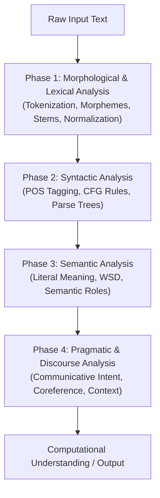

---

##### 2. Detailed Breakdown of the Four Main Phases & Key Tasks

#### Phase 1: Morphological and Lexical Analysis
* **Definition & Objective:** Analyzes words at the individual lexical level, focusing on their internal structure, formation, and constituent sub-word units called **morphemes** (roots, stems, prefixes, and suffixes).
* **Key Tasks Involved:**
  * **Word Boundary Detection & Tokenization:** Segmenting continuous text character streams into individual lexical tokens, handling punctuation, contractions, and compound words (e.g., `"don't"` $\to$ `["do", "n't"]`).
  * **Morphological Analysis:** Identifying root stems and morphological affixes. For example, the word *unhappiness* is decomposed into the prefix *un-*, base stem *happy*, and nominal suffix *-ness*.
  * **Stemming and Lemmatization:** Reducing inflectional and derivational variants to a common canonical base form (e.g., *eating*, *eats*, *ate* $\to$ *eat*).
  * **Stop-Word Removal:** Pruning high-frequency grammatical functional words (*the*, *is*, *at*, *which*) that carry negligible domain-specific semantic content.

#### Phase 2: Syntactic Analysis (Parsing)
* **Definition & Objective:** Focuses on the grammatical structure of sentences. It verifies whether a linear sequence of tokens obeys the formal grammar rules of the language (modeled via Context-Free Grammars, CFGs) and constructs hierarchical tree structures representing constituent relationships.
* **Key Tasks Involved:**
  * **Part-of-Speech (POS) Tagging:** Assigning syntactic categories (Noun `NN`, Verb `VB`, Adjective `JJ`, Preposition `IN`) to each token based on local context and transition probabilities.
  * **Constituency Parsing:** Grouping tokens into structural phrases such as Noun Phrases (NP) and Verb Phrases (VP) to construct a full derivation tree rooted at Sentence ($S$).
  * **Dependency Parsing:** Establishing directed syntactic relationships between head words and their dependents (e.g., `subject`, `direct object`, `modifier`).
  * **Grammar Checking & Syntax Disambiguation:** Resolving structural ambiguities such as Prepositional Phrase (PP) attachment.

#### Phase 3: Semantic Analysis
* **Definition & Objective:** Focuses on determining the literal, context-independent meaning of individual words, phrases, and composite sentences by combining lexical definitions with syntactic structures (compositional semantics).
* **Key Tasks Involved:**
  * **Word Sense Disambiguation (WSD):** Resolving the intended sense of polysemous or homonymous words based on surrounding context (e.g., identifying whether *"bank"* means a financial establishment or river boundary).
  * **Semantic Role Labeling (SRL):** Determining thematic roles (*who did what to whom, where, and when*) by mapping sentence constituents to roles like Agent, Patient, Instrument, and Theme.
  * **Named Entity Recognition (NER):** Detecting and categorizing entities such as Persons, Organizations, and Locations.
  * **Semantic Composition:** Translating natural language expressions into formal logical representations (First-Order Predicate Calculus or Lambda expressions).

#### Phase 4: Pragmatic and Discourse Analysis
* **Definition & Objective:** Interprets language in its broader communicative and situational context, accounting for speaker intent, non-literal meaning (metaphors, sarcasm), social conventions, and multi-sentence discourse flow.
* **Key Tasks Involved:**
  * **Coreference and Anaphora Resolution:** Linking pronouns or referring expressions across sentences to their actual antecedents (e.g., in *"John gave Mary a book. She loved it."*, resolving *"She"* $\to$ *Mary* and *"it"* $\to$ *book*).
  * **Speech Act Classification:** Determining the true communicative intent of an utterance (e.g., recognizing that *"Can you open the door?"* is an imperative request rather than an inquiry about physical ability).
  * **Discourse Structure Parsing:** Modeling coherence relations (e.g., elaboration, cause-effect, contrast) between consecutive sentences in a paragraph.
  * **World Knowledge & Metaphor Processing:** Interpreting idioms and figurative expressions that cannot be derived compositionally.

---

##### 3. Summary Comparison Table of NLP Phases

| Phase | Input | Primary Output | Linguistic Focus | Core Computational Methods |
| :--- | :--- | :--- | :--- | :--- |
| **1. Lexical / Morphological** | Raw Character Text | Standardized Tokens, Lemmas | Word formation, morphemes | FSTs, Regex, Porter Stemmer, WordNet |
| **2. Syntactic** | Token Stream | Parse Trees, Dependency Graphs | Grammatical legality, constituent hierarchy | CKY Parser, Earley Algorithm, HMM Taggers |
| **3. Semantic** | Parse Trees + Lexicon | Logical Semantic Forms, Case Roles | Literal context-free meaning | Lesk WSD, PropBank SRL, FrameNet |
| **4. Pragmatic / Discourse** | Semantic Representations + Dialogue Context | Situational Meaning, Dialogue Acts | Speaker intent, cross-sentence context | Hobbs' Algorithm, Coreference Chains, Classifiers |

---

##### 4. Conclusion
The four phases of NLP establish a pipeline that translates surface strings into actionable understanding. In modern neural language architectures (e.g., Transformers), these classical levels are learned jointly through multi-layer self-attention mechanisms.

---

### Question 1(b): Illustrate the applications of NLP and its organisation. [7 Marks]

#### Answer

##### 1. Introduction
Natural Language Processing systems bridge human linguistic communication and machine intelligence. To solve real-world problems, NLP systems are organized into structured architectures containing two complementary functional branches: **Natural Language Understanding (NLU)** and **Natural Language Generation (NLG)**.

---

##### 2. Organisation of NLP Systems
An NLP system is organized into a layered architecture supported by knowledge bases and specialized models:

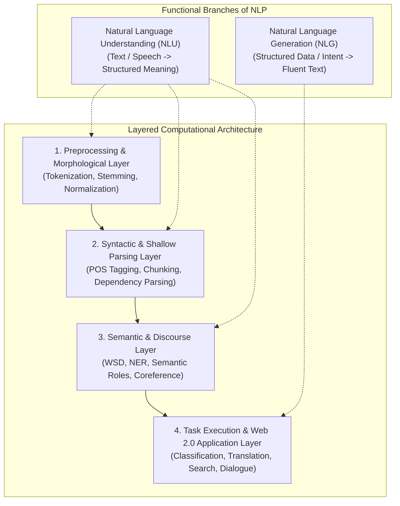

1. **Natural Language Understanding (NLU):**
   * Converts unstructured human text into machine-readable semantic representations.
   * Key functions: Syntactic parsing, entity extraction, sentiment detection, intent recognition.
2. **Natural Language Generation (NLG):**
   * Synthesizes natural human text from structured computational representations.
   * Three primary sub-stages:
     * *Text Planning:* Selecting relevant content and structuring communicative goals.
     * *Sentence Planning:* Selecting lexical terms, aggregating clauses, and enforcing coherence.
     * *Surface Realization:* Applying grammatical and morphological rules to generate the final text string.
3. **Layered System Organisation:**
   * **Preprocessing Layer:** Normalizes raw input, strips noise, and standardizes encodings.
   * **Linguistic Parsing Layer:** Employs statistical models (HMMs, CFGs) to extract syntactic structures.
   * **Semantic & Knowledge Layer:** Links tokens to knowledge graphs, domain ontologies (WordNet), and discourse memory.
   * **Application Delivery Layer:** Executes downstream end-user tasks.

---

##### 3. Major Applications of NLP (Aligned with Syllabus Module-V: Web 2.0 Applications)

1. **Robust and Scalable Machine Translation (MT):**
   * *Mechanism:* Automatically converts source language sentences into a target language while preserving semantic meaning and syntax.
   * *Architecture:* Statistical Machine Translation (SMT based on phrase tables and language models) and modern Neural Machine Translation (Seq2Seq Transformers with multi-head attention).
   * *Impact:* Removes multilingual barriers in global commerce, research, and governance.

2. **Sentiment Analysis and Opinion Mining:**
   * *Mechanism:* Analyzes customer reviews, social media feeds, and survey feedback to classify sentiment polarity (positive, negative, neutral) and subjectivity.
   * *Use Case:* Brand reputation management, political opinion polling, and consumer feedback triage.

3. **Information Extraction (IE) and Named Entity Recognition (NER):**
   * *Mechanism:* Scans unstructured text to identify entities (Person, Organization, Location, Date) and relations.
   * *Use Case:* Automated extraction of clinical symptoms and drug interactions from Electronic Health Records (EHR).

4. **Textual Entailment (Natural Language Inference - NLI):**
   * *Mechanism:* Determines whether a hypothesis sentence logically follows from, contradicts, or is neutral with respect to a premise text.
   * *Use Case:* Fact verification, automated grading, and fake news detection.

5. **Cross-Lingual Information Retrieval (CLIR) & Semantic Search:**
   * *Mechanism:* Allows users to query in one language (e.g., Hindi) and retrieve relevant documents written in another language (e.g., English) using multilingual dictionaries and shared vector spaces.
   * *Use Case:* Multinational document search and cross-lingual government databases.

6. **Question Answering Systems in Multilingual Settings:**
   * *Mechanism:* Extracts concise, factual answers to natural language questions from large text collections rather than simply returning links.
   * *Examples:* Factoid QA engines and Retrieval-Augmented Generation (RAG) assistants.

7. **Automatic Summarization & Dialogue Systems:**
   * *Summarization:* Produces concise summaries via extractive (TextRank) or abstractive (BART/T5) models.
   * *Dialogue Systems:* Task-oriented conversational agents (Siri, Alexa) and customer service bots.

---

##### 4. Summary Matrix of NLP Applications

| Application Domain | Primary NLP Functional Tasks | Syllabus Module Connection | Real-World Example |
| :--- | :--- | :--- | :--- |
| **Machine Translation** | Seq2Seq Modeling, Alignment, Beam Search | Module-V (Scalable MT) | Google Translate, DeepL |
| **Sentiment Analysis** | Text Classification, Lexicon Polarity Scoring | Module-V (Sentiment Analysis) | Brand24, Social Listening |
| **Named Entity Recognition** | Sequence Tagging, BIO Chunking, CRFs | Module-II & Module-V (NER) | SpaCy NER, Resume Parsers |
| **Text Entailment (NLI)** | Semantic Matching, Dense Vector Encoders | Module-V (Text Entailment) | Fact Checking Platforms |
| **Cross-Lingual IR (CLIR)** | Query Translation, Inverted Indexing, BM25 | Module-V (CLIR) & IT641 | Multilingual Search Engines |
| **Question Answering** | Information Retrieval, Span Extraction, RAG | Module-V (Multilingual QA) | Enterprise Knowledge Portals |

---

##### 5. Conclusion
Organizing NLP into modular NLU and NLG pipelines supported by standard linguistic layers allows developers to build scalable applications across translation, information retrieval, and conversational AI.

---
---

```
================================================================================
QUESTION 2
================================================================================
```

### Question 2(a): Compare and contrast between lemmatization and stemming with suitable examples. [7 Marks]

#### Answer

##### 1. Introduction to Word Normalization
In natural language processing and computational morphology (Syllabus Module-II: *Words and Word Forms*), words frequently appear in diverse surface forms due to inflectional marking (e.g., *walk*, *walks*, *walking*, *walked*) and derivational processes (e.g., *destruction* from *destroy*). 

**Stemming** and **lemmatization** are normalization techniques designed to map these morphological variants to a shared base form, reducing vocabulary sparsity in downstream language models. However, they rely on fundamentally different linguistic mechanisms.

---

##### 2. Comprehensive Comparison: Lemmatization vs. Stemming

| Comparison Dimension | Stemming | Lemmatization |
| :--- | :--- | :--- |
| **Core Definition** | An empirical, rule-based heuristic process that strips word affixes (suffixes and prefixes) without grammatical knowledge. | A linguistically grounded process that determines the canonical base form (**lemma**) using morphological analysis and dictionaries. |
| **Underlying Mechanism** | String slicing and suffix-stripping rules (e.g., drop `-ing`, replace `-ies` with `-i`). Does not reference a lexicon. | Morphological lookup utilizing a full lexical dictionary (e.g., WordNet), grammatical rules, and syntactic context. |
| **Output Validity** | Frequently produces non-words or truncated character sequences (e.g., *troubl*, *studi*). | Always produces a valid, dictionary-approved lemma (e.g., *trouble*, *study*). |
| **Part-of-Speech (POS) Sensitivity** | Completely POS-blind. Processes words identically regardless of whether they function as Nouns, Verbs, or Adjectives. | Context-sensitive; requires POS tags to disambiguate identical tokens (e.g., *meeting* as Noun vs. Verb). |
| **Handling Irregular Inflections** | Fails on irregular paradigms (e.g., *went* is not mapped to *go*; *better* is not mapped to *good*). | Successfully resolves irregular paradigms (e.g., *went* $\to$ *go*, *mice* $\to$ *mouse*, *better* $\to$ *good*). |
| **Computational Overhead** | Very fast, lightweight, and requires minimal memory (no dictionary search). | Slower and memory-intensive due to dictionary lookups and POS tag verification. |
| **Standard Implementations** | Porter Stemmer, Lancaster Stemmer, Snowball Stemmer. | WordNet Lemmatizer (NLTK), spaCy Lemmatizer, Stanford CoreNLP. |
| **Typical Failure Modes** | **Over-stemming:** Conflating distinct words (e.g., *universe* and *university* $\to$ *univers*).<br/>**Under-stemming:** Failing to link related forms (e.g., *alumnus* and *alumni*). | Misclassification when POS tagging fails or out-of-vocabulary words are missing from the lexicon. |
| **Primary Use Cases** | High-throughput Information Retrieval (search engines) where recall and speed matter more than linguistic precision. | Machine Translation, Question Answering, Sentiment Analysis, Text Generation, where grammatical validity is critical. |

---

##### 3. Illustrative Examples Comparison Table

| Input Word | POS Context | Stemming Output (Porter) | Lemmatization Output (WordNet) | Detailed Linguistic Analysis |
| :--- | :--- | :--- | :--- | :--- |
| **caring** | Verb / Adj | `care` | `care` (V) / `caring` (Adj) | Stemmer strips `-ing`. Lemmatizer preserves adjective if specified, or reduces to base verb. |
| **troubled** | Verb | `troubl` | `trouble` | Stemmer drops `-ed` leaving a non-word; lemmatizer reconstructs valid dictionary lemma. |
| **better** | Adjective | `better` | `good` | Stemmer cannot handle irregular comparative degrees; lemmatizer maps to base adjective `good`. |
| **was / were** | Auxiliary Verb| `wa` / `were` | `be` | Stemmer fails completely on suppletive irregular verbs; lemmatizer identifies root auxiliary `be`. |
| **corpora** | Noun (Plural) | `corpora` | `corpus` | Stemmer does not recognize classical Latin plural inflection; lemmatizer outputs singular lemma `corpus`. |
| **meeting** | Noun | `meet` | `meeting` | Stemmer chops to `meet`; lemmatizer recognizes *"a meeting"* as an independent noun concept. |
| **studies** | Noun / Verb | `studi` | `study` | Stemmer converts `-ies` to `-i`; lemmatizer applies orthographic inversion to return `study`. |

---

##### 4. Linguistic Perspective: Morphology Paradigms & Indian Languages
As emphasized in Module-II (*Morphological Diversity of Indian Languages*), rule-based suffix strippers like the Porter Stemmer are designed primarily for weakly inflected languages like English. In morphologically rich and agglutinative languages (e.g., Dravidian languages like Tamil/Kannada, and Indo-Aryan languages like Hindi/Bengali), words carry multiple chained morphemes (tense, aspect, mood, gender, number, person). Rule-based stemmers fail drastically on these languages, making **paradigm-based lemmatizers** and Finite State Transducers essential for Indian language processing.

---

##### 5. Conclusion
Stemming prioritizes runtime efficiency and index compactness in information retrieval tasks. Lemmatization prioritizes linguistic correctness, making it the preferred approach for semantically sensitive NLP applications.

---

### Question 2(b): How does normalization contribute to improve the quality of textual data. [7 Marks]

#### Answer

##### 1. Introduction
In natural language processing, **text normalization** is the foundational preprocessing phase that transforms raw, noisy, heterogeneous text into a clean, uniform, and standardized canonical format. Raw text generated across the web contains typographical errors, erratic punctuation, capitalization inconsistencies, slang, contractions, and varied morphological inflections.

As highlighted in the syllabus (Module-II: *Words and Word Forms* and Module-III: *Parsing on Noisy Text as in Web Documents*), unnormalized text impairs machine learning models. Normalization acts as a quality filter that directly improves downstream performance.

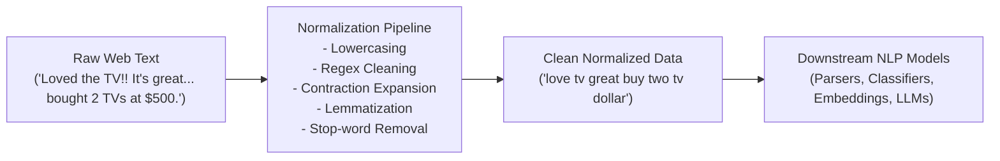

---

##### 2. Key Contributions of Normalization to Textual Data Quality

#### 1. Vocabulary Reduction and Sparsity Mitigation
* **The Problem:** In raw text, identical semantic units appear in multiple surface forms due to casing (*"Run"*, *"run"*, *"RUN"*) and inflection (*"runs"*, *"running"*, *"ran"*). In Bag-of-Words (BoW) or TF-IDF representations, each distinct string is assigned an independent feature dimension, causing the vocabulary size ($|V|$) to explode.
* **Normalization Impact:** Lowercasing and lemmatization collapse these variants into a single token (e.g., all map to *"run"*). This shrinks vocabulary size, mitigates matrix sparsity, and reduces the curse of dimensionality.

#### 2. Noise Reduction and Feature Standardization on Web Text
* **The Problem:** Scraped web documents contain HTML entities, non-standard unicode characters, emojis, character repetitions (*"coooool"*), and informal contractions (*"don't"*, *"can't"*).
* **Normalization Impact:** Regular expression cleaning, contraction expansion (*"do not"*, *"cannot"*), and unicode canonicalization (NFKC) eliminate non-informative artifacts, ensuring consistent semantic signals across documents.

#### 3. Minimization of Out-of-Vocabulary (OOV) Rates
* **The Problem:** Machine learning and neural embedding models assign penalty weights or uninformative `<UNK>` tags when encountering unseen word forms during inference.
* **Normalization Impact:** Reducing words to base lemmas and correcting misspellings increases the probability that test tokens match training vocabulary entries, lowering OOV penalties.

#### 4. Enhancing Information Retrieval Precision and Recall
* **The Problem:** A user searching for *"cloud computing platforms"* might miss documents discussing *"Cloud Computing Platform"* if matching is strictly literal.
* **Normalization Impact:** Standardizing case and number ensures high recall without sacrificing precision.

#### 5. Computational and Storage Efficiency
* **The Problem:** Massive vocabulary sizes require large parameter footprints (e.g., the embedding layer size $|V| \times d$ in neural networks consumes extensive GPU memory).
* **Normalization Impact:** Pruning rare words, removing stop words, and consolidating tokens reduces memory overhead and accelerates training and inference.

---

##### 3. Key Text Normalization Techniques & Quality Impacts

| Normalization Technique | Description & Concrete Example | Direct Data Quality Contribution |
| :--- | :--- | :--- |
| **Case Folding** | Converting text to uniform lowercase (`"Machine"` $\to$ `"machine"`). | Eliminates casing redundancies; prevents duplicate feature columns. |
| **Contraction Expansion** | Expanding short forms (`"don't"` $\to$ `"do not"`). | Standardizes negation and auxiliary verbs for accurate parsing and sentiment detection. |
| **Spelling & Typo Correction** | Correcting misspellings (`"definately"` $\to$ `"definitely"`). | Prevents vocabulary fragmentation and aligns noisy user input with pretrained embeddings. |
| **Unicode / Diacritic Stripping** | Converting accented characters (`"café"` $\to$ `"cafe"`). | Harmonizes cross-platform text encodings. |
| **Lemmatization / Stemming** | Reducing inflected words to lemmas (`"bought"` $\to$ `"buy"`). | Drastically compresses feature space while maintaining semantic cohesion. |
| **Punctuation & Noise Cleaning** | Stripping non-alphanumeric noise (`"$$%^&*"`). | Eliminates zero-information tokens from the statistical distribution. |

---

##### 4. Important Trade-Offs (Caution Against Over-Normalization)
While normalization improves data quality, aggressive over-normalization can destroy valuable linguistic nuances:
* Stripping capitalization causes ambiguity between common nouns and proper named entities (e.g., `"US"` country vs. `"us"` pronoun; `"Apple"` company vs. `"apple"` fruit).
* Stripping punctuation removes sentence boundary indicators (`.` and `?`) and emoticon sentiment signals (`:)` vs. `:(`).
* Stripping negation stop words (*"not"*, *"never"*) reverses the polarity of sentiment statements.

---

##### 5. Conclusion
Text normalization serves as the primary data quality filter in NLP pipelines. By reducing noise, consolidating vocabularies, and mitigating sparsity, it ensures that machine learning algorithms learn underlying linguistic patterns rather than surface orthographic variations.

---
---

```
================================================================================
QUESTION 3
================================================================================
```

### Question 3(a): Discuss the working of a two step morphological parses. [7 Marks]

> [!NOTE]
> **University Nomenclature Clarification:** In the examination paper, the question is printed as *"Discuss the working of a two step morphological parses."* In the standard NLP literature and syllabus (Module-II: *Words and Word Forms — Finite State Machine Based Morphology*), this refers to a **Two-Step Morphological Parser** based on Kimmo Koskenniemi's widely adopted **Two-Level Morphology model** using Finite State Transducers (FSTs).

#### Answer

##### 1. Introduction to Morphological Parsing
Morphological parsing is the computational task of taking an input word form and analyzing it into its constituent morphemes along with their grammatical features (Jurafsky & Martin, Ch. 3). For example, parsing the word *"cats"* produces the stem `cat` and the morphological feature `+N +PL`.

Because surface spelling changes occur whenever morphemes combine (e.g., *city + -s* $\to$ *cities*, *fox + -s* $\to$ *foxes*), modern morphological analyzers decouple this process into a **Two-Step Architecture** (Two-Level Morphology). This framework cleanly separates word-formation rules (morphotactics) from spelling-change rules (phonological/orthographic constraints).

---

##### 2. The Two-Step Computational Architecture
The two-step morphological parser separates linguistic knowledge into two distinct levels connected by an intermediate representation:

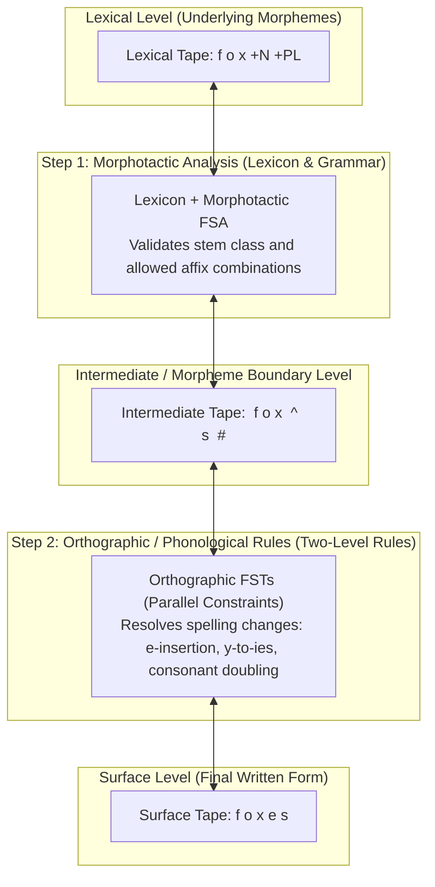

---

##### 3. Detailed Working of the Two Steps

#### Step 1: Morphotactics and Lexicon Lookup (Stem & Affix Validation)
* **Objective:** Handles which morphemes can co-occur and in what linear order.
* **Mechanism:**
  * Uses a structured **Lexicon** (repository of base stems, prefixes, and suffixes categorized into inflectional classes).
  * Governed by a **Finite State Automaton (FSA)** that enforces valid transitions between morpheme categories (e.g., `Prefix -> Root -> Derivational Suffix -> Inflectional Suffix`).
  * In the generation direction, it maps abstract grammatical features into base morphemes:
    $$\text{fox} + [N] + [PL] \longrightarrow \text{fox} \ \char`\^\ \text{s}$$
  * In the parsing direction, it confirms that `fox` is a recognized noun root and that `-s` is a permissible nominal plural suffix.

#### Step 2: Orthographic / Phonological Rule Processing (Spelling Adjustments)
* **Objective:** Resolves the spelling alterations that take place at morpheme boundaries (represented by the boundary symbol `^`).
* **Mechanism:**
  * Implemented using **Finite State Transducers (FSTs)** that execute two-level correspondence rules in parallel.
  * Standard English orthographic rules handled at this step include:
    1. **E-insertion Rule:** Insert an *e* when a suffix starting with *s* follows a sibilant (*s, x, z, ch, sh*):
       $$\epsilon \longrightarrow e \ / \ \{s, x, z, ch, sh\}\ \char`\^\ \_ \ s$$
    2. **Y-replacement Rule:** Change *y* to *ie* before suffix *-s* when preceded by a consonant:
       $$y \longrightarrow ie \ / \ C\ \char`\^\ \_ \ s \quad (\text{e.g., } \text{city} \ \char`\^\ \text{s} \to \text{cities})$$
    3. **Consonant Doubling (Gemination):** Doubling final consonant before vowel suffixes:
       $$b, g, p \longrightarrow bb, gg, pp \ / \ V\ \_\ \char`\^\ V \quad (\text{e.g., } \text{beg} \ \char`\^\ \text{ing} \to \text{begging})$$

---

##### 4. End-to-End Walkthrough of an Example Parse
Consider parsing the surface word **"foxes"** back into its lexical components:

1. **Surface Input:** `"foxes"`
2. **Execution of Step 2 (Orthographic Inverse Mapping):**
   * The surface string `"foxes"` passes through the inverse orthographic FST.
   * The transducer detects the environment where an inserted *e* precedes suffix *-s* after sibilant *x*.
   * It inverts the rule by removing *e* and inserting the morpheme boundary marker `^`:
     $$\text{"foxes"} \xrightarrow{\text{Inverse FST}} \text{"fox \char`\^ s"}$$
3. **Execution of Step 1 (Lexicon & Morphotactics Matching):**
   * The parser matches `"fox"` in the noun lexicon.
   * It transitions along the morphotactic FSA to identify that `"-s"` matches the plural noun inflection `+PL`.
4. **Final Lexical Output:**
   $$\text{"fox"} + [N] + [PL]$$

---

##### 5. Architectural Advantages of the Two-Step Model
* **Bidirectionality:** Because FSTs are mathematically reversible relations, the same two-step engine functions both for **parsing** (Surface $\to$ Lexical) and **generation** (Lexical $\to$ Surface).
* **Modularity:** Linguistic spelling rules are kept distinct from the vocabulary inventory. Adding new words to the lexicon requires no modifications to the orthographic transducers.
* **Linear Time Efficiency:** FSTs run in $O(n)$ time relative to the length of the input word.

---

##### 6. Conclusion
The two-step morphological parser provides a computationally elegant and linguistically grounded solution for natural language morphology. By separating morphotactic constraints from surface orthographic adjustments using FST cascades, it achieves efficient bidirectional parsing.

---

### Question 3(b): How would a finite state transducer work to map English Nouns ? [7 Marks]

#### Answer

##### 1. Introduction to Finite State Transducers (FST)
A **Finite State Transducer (FST)** is a two-tape automaton that computes a bidirectional mathematical mapping (relation) between two formal languages ($T \subseteq \Sigma^* \times \Delta^*$). Unlike an ordinary Finite State Automaton (FSA) that merely accepts or rejects strings, an FST reads from an input tape and writes to an output tape.

In computational morphology (Syllabus Module-II: *Finite State Machine Based Morphology* and Jurafsky & Martin Ch. 3), an FST maps between:
1. **The Lexical Tape:** The abstract sequence of stems and grammatical feature tags (e.g., `cat +N +PL`).
2. **The Surface Tape:** The concrete written orthographic form (e.g., `cats`).

---

##### 2. Morphological Structure of English Nouns
English noun morphology consists primarily of number inflection:
* **Regular Singular:** Unmarked base stem (e.g., *dog*, *book*).
* **Regular Plural:** Appending suffix *-s* (e.g., *dogs*) or *-es* after sibilants (*foxes*, *busses*, *watches*).
* **Y-stem Plurals:** Changing *-y* to *-ies* when preceded by a consonant (*baby* $\to$ *babies*).
* **Irregular Plurals:**
  * Vowel change / Ablaut (e.g., *man* $\to$ *men*, *foot* $\to$ *feet*, *mouse* $\to$ *mice*).
  * Invariant / Zero-marked plurals (e.g., *sheep* $\to$ *sheep*, *deer* $\to$ *deer*).
  * Foreign plurals (e.g., *criterion* $\to$ *criteria*, *stimulus* $\to$ *stimuli*).

---

##### 3. Architectural Design of the Noun FST
To handle both regular and irregular nouns, the FST is constructed by composing two specialized sub-transducers in series:

$$\text{Lexical Tape} \xrightarrow{\quad \mathcal{T}_{\text{morphotactics}} \quad} \text{Intermediate Tape} \xrightarrow{\quad \mathcal{T}_{\text{spelling}} \quad} \text{Surface Tape}$$

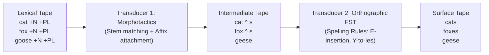

---

##### 4. State Transitions and Operation Walkthrough

#### Formal Specification of the Morphotactic Transducer ($\mathcal{T}_{\text{morph}}$)
* **States ($Q$):** $\{q_0, q_{\text{reg\_root}}, q_{\text{irreg\_root}}, q_{\text{singular}}, q_{\text{plural}}\}$
* **Start State:** $q_0$
* **Accepting States:** $\{q_{\text{singular}}, q_{\text{plural}}\}$

```
       [c:c]       [a:a]       [t:t]
(q0) -------> (q1) -------> (q2) -------> (q_reg)
                                             |
                   +N:ε                      |  +N:ε
             +-------------------------------+
             |
             v
         (q_noun)
          /    \
   +SG:ε /      \ +PL:^s
        v        v
     ((q_sg))  ((q_pl))
```

#### Transition Trace for Regular Nouns
1. **Case 1: Regular Plural without Spelling Change (`cat +N +PL` $\to$ `cats`)**
   * **Lexical Input:** `c a t +N +PL`
   * Morphotactic step: Maps `c:c`, `a:a`, `t:t`, `+N:\epsilon`, `+PL:^s` $\to$ Intermediate: `cat^s`.
   * Orthographic step: No sibilant at boundary; boundary marker `^` is deleted ($\char`\^\ :\epsilon$).
   * **Final Surface Output:** `cats`.

2. **Case 2: Regular Plural Requiring E-insertion (`fox +N +PL` $\to$ `foxes`)**
   * **Lexical Input:** `f o x +N +PL`
   * Morphotactic step: Maps `f:f`, `o:o`, `x:x`, `+N:\epsilon`, `+PL:^s` $\to$ Intermediate: `fox^s`.
   * Orthographic step: FST detects context: Sibilant `x` followed by boundary `^` and suffix `s`.
   * Transition rule applies: `^:e` (replace boundary marker with letter *e*).
   * Next transition: `s:s`.
   * **Final Surface Output:** `foxes`.

3. **Case 3: Consonant + Y Noun (`baby +N +PL` $\to$ `babies`)**
   * **Lexical Input:** `b a b y +N +PL`
   * Morphotactic step: Produces intermediate `baby^s`.
   * Orthographic step: Context rule triggers: Consonant (`b`) + `y` before `^s` maps `y^ : ie`.
   * **Final Surface Output:** `babies`.

4. **Case 4: Irregular Noun Mapping (`goose +N +PL` $\to$ `geese`)**
   * Irregular nouns bypass the default suffixation branch via dedicated lexical paths in the transducer:
   * Transition mapping: `g:g`, `o:e`, `o:e`, `s:s`, `e:e`, `+N:\epsilon`, `+PL:\epsilon`.
   * **Final Surface Output:** `geese`.

---

##### 5. Bidirectionality: Parsing vs. Generation
Because FST transitions are symmetric relations between input and output pairs ($I:O$), the exact same transducer functions in both directions without modification:

| Operation | Input Tape | Output Tape | Processing Direction |
| :--- | :--- | :--- | :--- |
| **Generation** | `fox +N +PL` | `foxes` | Top-down (Lexical to Surface) |
| **Parsing** | `foxes` | `fox +N +PL` | Bottom-up (Surface to Lexical) |
| **Generation** | `mouse +N +PL` | `mice` | Top-down (Irregular Lexical to Surface) |
| **Parsing** | `mice` | `mouse +N +PL` | Bottom-up (Irregular Surface to Lexical) |

---

##### 6. Conclusion
A finite state transducer efficiently maps English nouns between surface orthography and lexical feature representations. By using composed FST cascades for morphotactics and orthographic rules, the system handles regular inflections, spelling mutations, and irregular paradigms in deterministic, linear time $O(n)$.

---
---

```
================================================================================
QUESTION 4
================================================================================
```

### Question 4(a): Identify and describe the ambiguities in the following sentences: [7 Marks]
(i) She loves small animal
(ii) Book that train
(iii) The woman kept the cat in the house

#### Answer

##### 1. Introduction to Linguistic Ambiguity in NLP
In natural language processing and computational syntax (Syllabus Module-III: *Structures — Scope Ambiguity and Attachment Ambiguity Resolution*), **ambiguity** is a pervasive challenge occurring when a linguistic expression permits multiple legitimate interpretations. 

NLP parsers classify ambiguity into three major categories:
1. **Lexical / Part-of-Speech Ambiguity:** Individual words belong to multiple grammatical categories or word senses.
2. **Syntactic / Structural Ambiguity:** Words can be grouped into different hierarchical constituent trees (e.g., Prepositional Phrase attachment).
3. **Scope & Semantic Ambiguity:** Operators (quantifiers, negation, adjectives) take scope over different constituent parts of a sentence.

---

##### 2. Detailed Identification and Description of Ambiguities

---

#### Sentence (i): *"She loves small animal"*

* **Identified Ambiguity Types:** **Scope Ambiguity** and **Morpho-Syntactic / Countability Ambiguity**.
* **Detailed Linguistic Description:**
  1. **Countable vs. Mass Noun (Countability Ambiguity):**
     * In standard English grammar, the noun *"animal"* is countable and normally requires either a determiner (e.g., *"a small animal"*) or plural inflection (*"small animals"*).
     * **Interpretation A (Generic Mass / Substance Sense):** *"Animal"* is interpreted uncountably as a mass noun (analogous to *"She loves chicken"* or *"She loves fish"*), indicating an affection for animal meat, animal fur, or wildlife in a generic, non-discrete sense.
     * **Interpretation B (Elliptical Singular Countable Sense):** The sentence represents an informal or telegraphic omission of the indefinite article, meaning *"She loves a particular small animal"* (e.g., her pet rabbit).
  2. **Adjectival Scope Ambiguity:**
     * Does the adjective *"small"* take scope over the individual physical size of the animal (a miniature creature), or does it denote a taxonomic subclass / developmental stage (infant/baby animals)?

---

#### Sentence (ii): *"Book that train"*

* **Identified Ambiguity Types:** **Lexical / Part-of-Speech (POS) Category Ambiguity** and **Semantic Sense Ambiguity**.
* **Detailed Linguistic Description:**
  * Both the word **"Book"** and the word **"train"** can function as either a **Noun** or a **Verb**. This yields two competing syntactic parse structures:
  1. **Interpretation A (Imperative Verb Phrase — Most Common):**
     * *"Book"* is an imperative **Verb** (meaning to make a travel reservation).
     * *"that"* is a demonstrative **Determiner** modifying the object noun.
     * *"train"* is a **Noun** (the locomotive railway vehicle).
     * *Syntactic Structure:* `[S [VP [V Book] [NP [Det that] [N train]]]]`
     * *Meaning:* *"Please make a ticket reservation on that specific railway train."*
  2. **Interpretation B (Noun Phrase with Relative Clause / Modifier):**
     * *"Book"* is a **Noun** (a published printed literary volume).
     * *"that"* is a relative **Pronoun** introducing a relative clause.
     * *"train"* is a finite **Verb** (to educate, coach, or instruct).
     * *Syntactic Structure:* `[NP [N Book] [RC [Rel that] [V train]]]`
     * *Meaning:* *"The specific educational book that trains individuals."*
  3. **Interpretation C (Compound Nominal Modifier):**
     * *"Book"* functions as an attributive noun modifying *"train"*, describing a railway cargo train dedicated to transporting books.

---

#### Sentence (iii): *"The woman kept the cat in the house"*

* **Identified Ambiguity Types:** **Structural Attachment Ambiguity (Prepositional Phrase Attachment)**.
* **Detailed Linguistic Description:**
  * This is the canonical example of **Attachment Ambiguity** explicitly highlighted in Module-III of the syllabus. The prepositional phrase (PP) **"in the house"** can attach to two distinct syntactic nodes in the parse tree:

  1. **Interpretation A: Verb Phrase (VP) Attachment (Locative Modifier of Action)**
     * The PP attaches directly to the **Verb Phrase (VP)** headed by *"kept"*.
     * *Linguistic Interpretation:* The keeping or confining of the cat occurred inside the house. (The house is the location of the action; the woman was in the house keeping the cat, or she kept the cat indoors).
     * *Parse Tree Structure:*
       ```
                 S
              /     \
            NP       VP
           /  \     / |  \
         Det   N   V  NP  PP [in the house]
          |    |   |  / \
         The woman kept Det N
                         |  |
                        the cat
       ```

  2. **Interpretation B: Noun Phrase (NP) Attachment (Nominal Post-Modifier)**
     * The PP attaches directly to the **Noun Phrase (NP)** headed by *"the cat"*.
     * *Linguistic Interpretation:* There were multiple cats in different locations (e.g., one cat in the garden, one cat in the house). The woman decided to keep the specific cat that was located inside the house.
     * *Parse Tree Structure:*
       ```
                 S
              /     \
            NP       VP
           /  \     /  \
         Det   N   V    NP
          |    |   |   /  \
         The woman kept NP  PP [in the house]
                       / \
                     Det  N
                      |   |
                     the cat
       ```

---

##### 3. How NLP Systems Resolve Scope and Attachment Ambiguities (Syllabus Module-III)
As prescribed in Module-III (*"Scope Ambiguity and Attachment Ambiguity resolution; Hybrid of Rule Based and Probabilistic Parsing"*):
1. **Probabilistic Context-Free Grammars (PCFGs):** Assign probabilities to grammar productions ($P(A \to \alpha)$). The parser computes the joint probability of each derivation tree:
   $$P(\text{Tree}) = \prod_{i} P(A_i \longrightarrow \alpha_i)$$
   The derivation with the highest probability is selected.
2. **Lexical Association & PP-Attachment (Hindle & Rooth Approach):** Calculates the co-occurrence likelihood of the verb with the preposition $P(\text{Prep} \mid \text{Verb})$ versus the noun with the preposition $P(\text{Prep} \mid \text{Noun})$ using corpus counts.
3. **Contextual Embeddings (BERT):** Transformer attention heads attend across full sentence context to capture semantic affinity between *"kept"* and *"in the house"*.

---

##### 4. Summary Matrix of Sentence Ambiguities

| Sentence | Primary Ambiguity Type | Competing Interpretations | Syllabus Disambiguation Technique |
| :--- | :--- | :--- | :--- |
| **(i) She loves small animal** | Scope / Mass-Count Ambiguity | Mass meat/substance sense vs. singular countable animal with missing article. | N-gram language models, selectional restrictions. |
| **(ii) Book that train** | Lexical / POS Category Ambiguity | Imperative Verb Phrase (Reserve tickets) vs. Noun Phrase (Book that instructs). | HMM / CRF Part-of-Speech Taggers. |
| **(iii) The woman kept the cat in the house** | Structural Attachment Ambiguity | VP-Attachment (Action inside house) vs. NP-Attachment (The house cat). | Probabilistic CFG (PCFG), Hindle-Rooth Lexical Affinity. |

---

##### 5. Conclusion
Natural language sentences exhibit multi-level ambiguities. Addressing lexical, scope, and structural attachment ambiguities requires moving beyond rigid rule-based parsers toward hybrid probabilistic models (PCFGs) and contextual language models.

---

### Question 4(b): What are the problems associated with an n-gram model ? [7 Marks]

#### Answer

##### 1. Introduction to N-Gram Language Models
An **N-gram language model** is a statistical model that predicts the probability of an incoming word given its preceding history. Using the **Markov assumption**, an $n$-gram model approximates the probability of the current word $w_k$ by conditioning only on the preceding $n-1$ words rather than the complete sentence history (Jurafsky & Martin, Ch. 4):

$$P(w_1, w_2, \dots, w_m) = \prod_{k=1}^m P(w_k \mid w_1, \dots, w_{k-1}) \approx \prod_{k=1}^m P(w_k \mid w_{k-n+1}, \dots, w_{k-1})$$

Under Maximum Likelihood Estimation (MLE), probabilities are calculated directly from corpus frequency counts:

$$P_{\text{MLE}}(w_k \mid w_{k-n+1}^{k-1}) = \frac{C(w_{k-n+1}^{k})}{C(w_{k-n+1}^{k-1})} = \frac{C(w_{k-n+1}, \dots, w_{k-1}, w_k)}{C(w_{k-n+1}, \dots, w_{k-1})}$$

N-gram models are widely used as the prior language model $P(W)$ in **argmax-based computations** for Speech Recognition (Module-I) and Statistical Machine Translation (Module-V):

$$\hat{W} = \arg\max_{W} P(A \mid W) \cdot P(W)$$

Despite their mathematical simplicity, n-gram models suffer from severe theoretical and practical limitations.

---

##### 2. Major Problems Associated with N-Gram Models

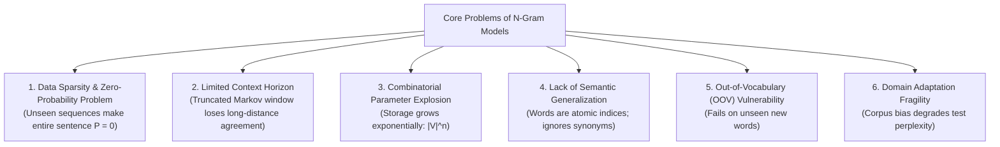

---

#### 1. Data Sparsity and the Zero-Probability Problem
* **Explanation:** Language is open-ended. Even in massive training corpora, the vast majority of valid word sequences never appear. If a specific n-gram tuple has count $C(w_{k-n+1}^k) = 0$, its MLE probability evaluates to zero:
  $$P(w_k \mid w_{k-n+1}^{k-1}) = 0$$
* **Impact:** Because sentence probability is calculated as a product of terms, a single zero probability forces the **entire sentence probability to become zero**:
  $$P(\text{Sentence}) = \prod P(w_i \mid \dots) = 0$$
* **Mitigation Drawbacks:** Smoothing techniques (Laplace, Good-Turing, Kneser-Ney) redistribute probability mass to unseen events, but require complex hyperparameter tuning and degrade sharp probability peaks.

#### 2. Limited Context Horizon (Short-Range Memory)
* **Explanation:** Due to the $(n-1)$ Markov assumption, an n-gram model is blind to words outside its immediate window. For a trigram model ($n=3$), predictions rely solely on the previous 2 words.
* **Impact:** The model cannot capture **long-distance dependencies** or structural syntactic constraints common in human language:
  * *Example:* *"The **books** that I borrowed yesterday from the central library **were** / **was** fascinating."*
  * Because the plural subject *"books"* is separated from the auxiliary verb by seven words, a trigram model only sees `("central", "library")` and erroneously assigns higher probability to singular *"was"*.

#### 3. Combinatorial / Exponential Parameter Explosion
* **Explanation:** The theoretical parameter space of an n-gram model scales exponentially with the order $n$:
  $$\text{Parameters} = \mathcal{O}(|V|^n)$$
  where $|V|$ is the vocabulary size.
* **Impact:** For a realistic vocabulary of $|V| = 100,000$ words:
  * Unigram ($n=1$): $10^5$ parameters.
  * Bigram ($n=2$): $10^{10}$ parameters.
  * Trigram ($n=3$): $10^{15}$ parameters.
* Storing, loading, and querying these massive count matrices causes severe RAM and disk bottlenecks; practical models rarely exceed $n=4$ or $n=5$.

#### 4. Complete Absence of Semantic Generalization
* **Explanation:** N-gram models treat words as atomic, independent symbols (discrete categorical tokens). They have no concept of semantic similarity between words.
* **Impact:** Observing the trigram `"the cat slept"` provides zero statistical support for `"the kitten slept"` or `"the feline slept"`. The model must learn separate frequency counts for every synonym, leading to inefficient parameter utilization compared to distributed representations (word embeddings).

#### 5. Vulnerability to Out-of-Vocabulary (OOV) Words
* **Explanation:** Real-world text frequently contains proper nouns, technical jargon, slang, and morphological inflections absent from the training vocabulary.
* **Impact:** Without specialized `<UNK>` tokens, n-gram models cannot compute probabilities for text containing unseen words. Introducing `<UNK>` tokens introduces artificial probability distortions.

#### 6. Sensitivity to Domain Shift and Corpus Bias
* **Explanation:** Frequency distributions of n-grams vary drastically across genres (e.g., biomedical research vs. casual Twitter/X posts).
* **Impact:** An n-gram model trained on Wall Street Journal articles exhibits poor perplexity when evaluated on colloquial dialogues or medical literature.

---

##### 3. Summary Comparison: N-Gram Models vs. Modern Neural Language Models

| Dimension | Classical N-Gram Model | Neural Language Models (RNN / Transformer) |
| :--- | :--- | :--- |
| **Context Length** | Strictly fixed ($n-1$ words; typically 2 to 4). | Flexible / Massive (thousands of tokens via self-attention). |
| **Word Representation** | Discrete atomic symbols (one-hot IDs). | Continuous dense semantic vectors (Embeddings). |
| **Zero-Count Handling** | Requires heuristic smoothing (Kneser-Ney). | Implicit generalization via continuous vector spaces. |
| **Parameter Scaling** | Exponential $\mathcal{O}(|V|^n)$ with context size. | Linear / Quadratic with sequence length; shared weights. |
| **Syntactic Agreement** | Fails on long-range agreements. | Successfully resolves long-distance dependencies. |

---

##### 4. Conclusion
The fundamental flaws of n-gram models—data sparsity, exponential storage growth, and lack of semantic generalization—established an upper bound on statistical NLP capabilities. These limitations directly motivated the transition to distributed word representations (Word2Vec) and modern deep neural architectures (Transformers).

---
---

```
================================================================================
QUESTION 5
================================================================================
```

### Question 5(a): Explain the dynamic paging parsing algorithm with an example. [7 Marks]

> [!NOTE]
> **University Syllabus & Nomenclature Clarification:** The examination paper prints *"Explain the dynamic paging parsing algorithm with an example."* In standard Computer Science and Natural Language Processing literature (Syllabus Module-III: *Structures — Theories of Parsing, Parsing Algorithms*), "dynamic paging parsing" is an apparent typographical error for **Dynamic Programming Parsing** (specifically the **Cocke-Younger-Kasami (CKY)** algorithm and **Earley Chart Parsing**). We provide the complete theoretical derivation, algorithmic steps, working example, and chart table for dynamic programming parsing via the CKY algorithm, along with an overview of the Earley parsing algorithm.

#### Answer

##### 1. Introduction to Dynamic Programming Parsing
Parsing natural language using naive recursive backtracking (such as top-down recursive descent or bottom-up shift-reduce) exhibits **exponential time complexity** ($\mathcal{O}(2^n)$ or $\mathcal{O}(k^n)$) because it repeatedly re-derives identical sub-phrases across failed backtracking paths.

**Dynamic Programming Parsing** resolves this inefficiency by storing intermediate sub-tree derivations in a shared tabular chart (memoization matrix). Once a phrase spanning words from index $i$ to $j$ is parsed, its non-terminal category is recorded and reused in $\mathcal{O}(1)$ time. 

The two canonical dynamic programming parsing algorithms in the NLP syllabus are:
1. **The Cocke-Younger-Kasami (CKY) Algorithm:** Bottom-up dynamic programming parser operating on grammars in Chomsky Normal Form (CNF).
2. **The Earley Algorithm:** Top-down dynamic programming chart parser operating directly on arbitrary CFGs without CNF conversion using dotted rules (`A -> alpha . beta`).

---

##### 2. The CKY Parsing Algorithm

#### Prerequisites: Chomsky Normal Form (CNF)
For CKY parsing to operate, the Context-Free Grammar (CFG) must be in **Chomsky Normal Form (CNF)**, where all production rules adhere to one of two forms:
1. $A \longrightarrow B \ C$ (A non-terminal derives exactly two non-terminals)
2. $A \longrightarrow a$ (A non-terminal derives exactly one terminal word)

#### Algorithmic Principle:
Given an input sentence of $n$ words, $w_1, w_2, \dots, w_n$:
* A two-dimensional triangular chart `table[n+1, n+1]` is constructed.
* Cell `table[i, j]` stores the set of all non-terminal grammar symbols that span the words from index $i$ to $j$.

#### Step-by-Step Procedure:
1. **Base Case (Spans of Length $l = 1$):**
   * Fill diagonal cells `table[i-1, i]` for each word $w_i$.
   * If rule $A \longrightarrow w_i$ exists, add $A$ to `table[i-1, i]`.
2. **Recursive Step (Spans of Length $l = 2 \text{ to } n$):**
   * For each span length $l$ from $2$ to $n$:
     * For each start position $i$ from $0$ to $n-l$:
       * Set end position $j = i + l$.
       * For every intermediate split point $k$ from $i+1$ to $j-1$:
         * If non-terminals $B \in \text{table}[i, k]$ and $C \in \text{table}[k, j]$, and a production $A \longrightarrow B \ C$ exists in the grammar, add $A$ to `table[i, j]`.
3. **Acceptance:** The sentence is syntactically valid if the start symbol $S$ is in `table[0, n]`.

---

##### 3. Complete Working Example of CKY Parsing

#### Given Grammar $G$ in Chomsky Normal Form:
* $S \longrightarrow NP \ VP$
* $VP \longrightarrow V \ NP$
* $NP \longrightarrow \text{Det} \ N \ \mid \ \text{"she"}$
* $V \longrightarrow \text{"eats"}$
* $\text{Det} \longrightarrow \text{"the"}$
* $N \longrightarrow \text{"fish"}$

#### Sentence to Parse:
$$\text{"she eats the fish"} \quad (n = 4 \text{ words})$$
Indices:
* Position 0 to 1: `"she"`
* Position 1 to 2: `"eats"`
* Position 2 to 3: `"the"`
* Position 3 to 4: `"fish"`

---

#### Step-by-Step Execution:

* **Length $l = 1$ (Diagonal Cells):**
  * `table[0, 1]` for `"she"`: Rule $NP \longrightarrow \text{"she"} \implies \mathbf{\{NP\}}$
  * `table[1, 2]` for `"eats"`: Rule $V \longrightarrow \text{"eats"} \implies \mathbf{\{V\}}$
  * `table[2, 3]` for `"the"`: Rule $\text{Det} \longrightarrow \text{"the"} \implies \mathbf{\{Det\}}$
  * `table[3, 4]` for `"fish"`: Rule $N \longrightarrow \text{"fish"} \implies \mathbf{\{N\}}$

* **Length $l = 2$:**
  * **Span `[0, 2]` (`"she eats"`):** Split $k=1$. Check `table[0,1]` ($\{NP\}$) & `table[1,2]` ($\{V\}$). No rule $A \to NP \ V \implies \mathbf{\emptyset}$.
  * **Span `[1, 3]` (`"eats the"`):** Split $k=2$. Check `table[1,2]` ($\{V\}$) & `table[2,3]` ($\{Det\}$). No rule $A \to V \ Det \implies \mathbf{\emptyset}$.
  * **Span `[2, 4]` (`"the fish"`):** Split $k=3$. Check `table[2,3]` ($\{Det\}$) & `table[3,4]` ($\{N\}$). Rule exists: $NP \longrightarrow Det \ N \implies \mathbf{\{NP\}}$.

* **Length $l = 3$:**
  * **Span `[0, 3]` (`"she eats the"`):** Splits $k=1, 2$. Both yield empty combinations $\implies \mathbf{\emptyset}$.
  * **Span `[1, 4]` (`"eats the fish"`):** Split $k=2$. Check `table[1,2]` ($\{V\}$) & `table[2,4]` ($\{NP\}$). Rule exists: $VP \longrightarrow V \ NP \implies \mathbf{\{VP\}}$.

* **Length $l = 4$ (Full Sentence Span `[0, 4]`):**
  * Split $k=1$: Check `table[0,1]` ($\{NP\}$) & `table[1,4]` ($\{VP\}$). Rule exists: $S \longrightarrow NP \ VP \implies \mathbf{\{S\}}$.

---

##### 4. Completed CKY Dynamic Programming Chart

| | Column 1: "she" | Column 2: "eats" | Column 3: "the" | Column 4: "fish" |
| :---: | :---: | :---: | :---: | :---: |
| **Row 0** | **{NP}** | $\emptyset$ | $\emptyset$ | **{S}** *(Accepted)* |
| **Row 1** | — | **{V}** | $\emptyset$ | **{VP}** |
| **Row 2** | — | — | **{Det}** | **{NP}** |
| **Row 3** | — | — | — | **{N}** |

Following back-pointers from cell `[0, 4]` constructs the final derivation parse tree:

```
          S
       /     \
     NP       VP
     |       /  \
   "she"    V    NP
            |   /  \
         "eats" Det N
                 |  |
               "the" "fish"
```

---

##### 5. Computational Complexity Analysis
* **Time Complexity:** $\mathcal{O}(n^3 \cdot |G|)$, where $n$ is sentence length and $|G|$ is the number of grammar productions. The three nested loops ($l, i, k$) iterate $\mathcal{O}(n^3)$ times. This is a dramatic polynomial improvement over naive $\mathcal{O}(2^n)$ backtracking.
* **Space Complexity:** $\mathcal{O}(n^2 \cdot |G|)$ to store the tabular matrix.

---

##### 6. Conclusion
Dynamic programming parsing via the CKY and Earley algorithms replaces exponential recursive backtracking with tabular memoization, guaranteeing polynomial-time parsing for complex and ambiguous natural language grammars.

---

### Question 5(b): Define NER. How do NER differ from traditional parts of speech tagging ? [7 Marks]

#### Answer

##### 1. Definition of Named Entity Recognition (NER)
**Named Entity Recognition (NER)** (also known as entity chunking) is an Information Extraction task that locates and classifies mentions of rigid designators in unstructured text into predefined semantic categories (Syllabus Module-II: *Shallow Parsing; Named Entities* and Module-V: *Web 2.0 Applications*).

Standard entity categories include:
* **Universal Categories:** `PERSON` (e.g., *Alan Turing*), `ORGANIZATION` (e.g., *Microsoft*), `LOCATION` / `GPE` (e.g., *New Delhi*), `DATE/TIME` (e.g., *August 15, 1947*), `MONEY` (e.g., *\$10 million*).
* **Domain-Specific Categories:** Biomedical (`GENE`, `DISEASE`), Legal (`STATUTE`, `COURT`), Financial (`TICKER`, `CURRENCY`).

*Example:*
> `"[Sundar Pichai]"` $_{\text{PERSON}}$ `"is the CEO of"` `"[Google]"` $_{\text{ORG}}$ `"headquartered in"` `"[California]"` $_{\text{LOC}}$ `"."`

---

##### 2. Definition of Parts-of-Speech (POS) Tagging
**Parts-of-Speech (POS) Tagging** is a foundational syntactic classification task that assigns a grammatical word category (such as Noun, Verb, Adjective, Preposition, Conjunction) to every individual token in a sentence based on its syntactic function and local grammatical context (Jurafsky & Martin, Ch. 5).

*Example:*
> `"Sundar/NNP Pichai/NNP is/VBZ the/DT CEO/NN of/IN Google/NNP headquartered/VBN in/IN California/NNP ./."`

---

##### 3. Detailed Comparison: NER vs. Traditional POS Tagging

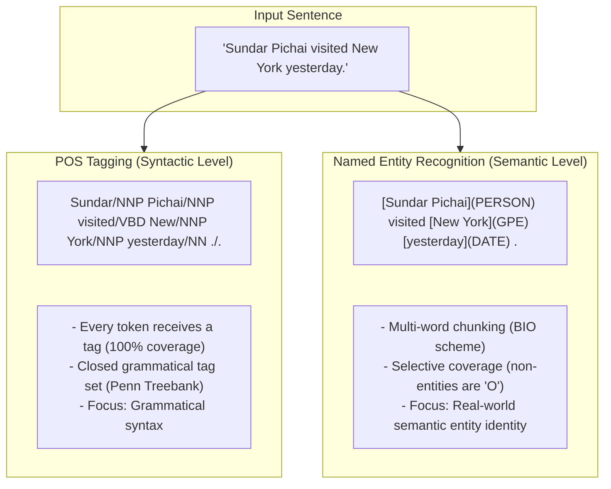

---

##### 4. Comprehensive Comparison Table

| Dimension | Parts-of-Speech (POS) Tagging | Named Entity Recognition (NER) |
| :--- | :--- | :--- |
| **Linguistic Level** | **Syntactic:** Focuses on grammatical roles and syntactic structure. | **Semantic / Pragmatic:** Focuses on real-world reference and meaning. |
| **Token Coverage** | **Universal / Dense (100%):** Every single token (including punctuation) is assigned a tag. | **Sparse / Selective:** Only informative entity mentions are tagged; non-entities receive the default `O` (Outside) tag. |
| **Unit of Tagging** | **Single Token:** Evaluates one word at a time (e.g., *New/NNP York/NNP*). | **Multi-Token Spans (Chunks):** Entities span multiple tokens, requiring boundary schemes (BIO/BILOU) (e.g., *B-LOC, I-LOC*). |
| **Tag Set Size & Nature** | **Fixed & Closed:** Standardized linguistic sets (e.g., Penn Treebank with 36/45 tags, Universal Dependencies with 17 tags). | **Extensible & Domain-Dependent:** Custom tag sets adapted to domain needs (e.g., Gene, Drug, Product, Law). |
| **Ambiguity Nature** | **Syntactic Ambiguity:** e.g., determining whether *"run"* is a Noun or a Verb. | **Referential / Real-world Ambiguity:** e.g., determining whether *"Washington"* is a Person, City, State, or Sports team. |
| **External Knowledge Needed** | Relies primarily on local syntax, suffixes, and neighboring word classes. | Heavily dependent on world knowledge, gazetteers, and broad semantic context. |
| **Evaluation Metrics** | Accuracy / Macro-Averaged F1 across all tokens. | Strict span-level Precision, Recall, and F1-score (exact boundary and class match). |
| **Role in NLP Pipeline** | Upstream core task; often serves as an input feature for parsers and NER taggers. | Downstream extraction task; directly populates knowledge graphs and databases. |

---

##### 5. Computational Modeling: Shallow Parsing and CRFs (Syllabus Module-II)
Module-II explicitly highlights **Shallow Parsing, Maximum Entropy Models, and Random Fields (CRFs)**:
* **The BIO Tagging Scheme:** Because named entities span multiple words, NER uses boundary schemes:
  * `B-Entity`: Beginning of an entity mention.
  * `I-Entity`: Inside / continuation of an entity mention.
  * `O`: Outside any named entity.
* **Why CRFs are Preferred over HMMs for NER:**
  * POS tagging is often addressed using Hidden Markov Models (HMMs).
  * NER requires rich overlapping features (capitalization, gazetteer lookups, prefix/suffix shapes). HMMs cannot handle dependent overlapping features due to independence assumptions.
  * **Linear-Chain Conditional Random Fields (CRFs)**—explicitly listed in Module-II—model the conditional distribution $P(Y \mid X)$ globally, preventing the label bias problem and enforcing valid state transitions (e.g., `I-PERSON` cannot follow `B-LOCATION`).

---

##### 6. Conclusion
POS tagging operates at the syntactic level to label grammatical word classes for all tokens. NER operates at the semantic level to extract structured, multi-word real-world entities. POS features often serve as critical inputs for statistical and neural NER models.

---
---

```
================================================================================
QUESTION 6
================================================================================
```

### Question 6(a): Explain the design, features of Information Retrival system. [7 Marks]

> [!NOTE]
> **University Spelling Preservation:** The examination paper prints this question as *"Explain the design, features of Information Retrival system."* (preserving the paper's original spelling of Retrieval).

#### Answer

##### 1. Introduction
An **Information Retrieval (IR) System** is a software architecture designed to discover, index, rank, and retrieve relevant unstructured or semi-structured documents from massive document collections in response to an ad-hoc natural language query (Jurafsky & Martin, Ch. 23 and Syllabus Module-V: *Cross Lingual Information Retrieval*).

Unlike Relational Database Management Systems (RDBMS) that perform exact relational filtering via deterministic SQL queries, an IR system operates under **semantic uncertainty**, computing probabilistic **relevance scores** to satisfy an information need.

---

##### 2. Architectural Design of an Information Retrieval System
The operational architecture of an IR system is divided into two distinct subsystems:
1. **The Offline Indexing Subsystem:** Crawls, parses, normalizes, and structures documents into search indexes prior to query time.
2. **The Online Query and Ranking Subsystem:** Ingests user queries, searches index tables, scores matching documents, and delivers ranked results in real time.

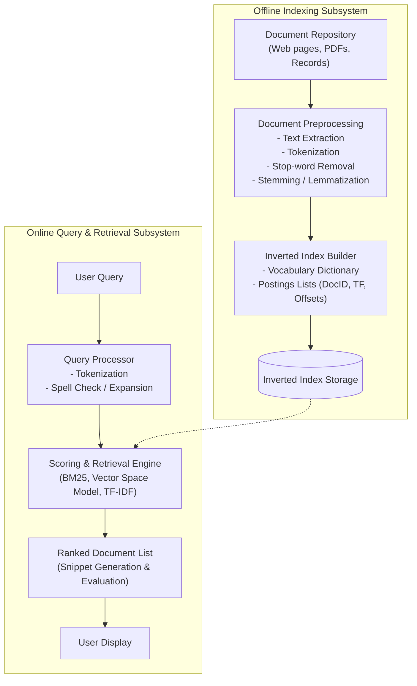

---

##### 3. Detailed Component Design

#### 1. Document Preprocessing Pipeline
* **Tokenization:** Splitting continuous document streams into discrete linguistic tokens.
* **Text Normalization:** Stripping markup tags (HTML/XML), converting to lowercase, and handling punctuation.
* **Stop-Word Elimination:** Removing non-discriminating functional words (*a*, *an*, *the*, *of*) to prune index volume.
* **Stemming / Lemmatization:** Collapsing words to common roots (e.g., *retrieving*, *retrieval* $\to$ *retriev*) using Porter or Snowball algorithms.

#### 2. The Inverted Index (Core Data Structure)
The inverted index is the fundamental data structure enabling sub-second search over billions of documents. It maps every distinct vocabulary term to a **postings list** containing the documents in which the term appears:
* **Lexicon / Dictionary:** The sorted vocabulary of unique terms.
* **Postings List:** A linked list or contiguous array for each term containing:
  * `DocID`: The document identifier.
  * `Term Frequency (TF)`: How many times the term occurs in that document.
  * `Positional Offsets`: Character locations for phrase and proximity queries.

$$\text{Term} \longrightarrow [(\text{Doc}_1, \text{TF}=3, \text{pos}=\langle 12, 45, 90 \rangle), (\text{Doc}_5, \text{TF}=1, \text{pos}=\langle 8 \rangle), \dots]$$

#### 3. Online Query Processor & Ranking Engine
* **Query Parsing:** Transforming raw query strings into formal internal query representations.
* **Query Expansion:** Adding synonyms or using pseudo-relevance feedback to overcome vocabulary mismatch.
* **Matching & Scoring Function:** Evaluating matching candidate documents against the query vector.

---

##### 4. Core Features of Modern Information Retrieval Systems

1. **Diverse Mathematical Retrieval Models:**
   * **Boolean Model:** Exact set-theoretic retrieval matching Boolean operators (`AND`, `OR`, `NOT`).
   * **Vector Space Model (VSM):** Represents documents and queries as high-dimensional vectors weighted by **TF-IDF**:
     $$\text{TF-IDF}(t, d, D) = \text{TF}(t, d) \times \log\left(\frac{|D|}{|\{d \in D : t \in d\}|}\right)$$
     Relevance is scored via **Cosine Similarity**:
     $$\text{Cosine}(\vec{q}, \vec{d}) = \frac{\vec{q} \cdot \vec{d}}{\|\vec{q}\| \|\vec{d}\|}$$
   * **Probabilistic Model (BM25):** The industry standard for keyword search. Incorporates term frequency saturation and document length normalization:
     $$\text{Score}(D, Q) = \sum_{i=1}^n \text{IDF}(q_i) \cdot \frac{\text{TF}(q_i, D) \cdot (k_1 + 1)}{\text{TF}(q_i, D) + k_1 \cdot \left(1 - b + b \cdot \frac{|D|}{\text{avgdl}}\right)}$$

2. **Relevance Feedback:**
   * Adjusts the query vector using user click-through data or explicit relevance judgements (Rocchio Algorithm).

3. **Faceted Search and Filtering:**
   * Enables users to narrow results across multiple metadata attributes (date, author, file type, category).

4. **Cross-Lingual Information Retrieval (CLIR - Syllabus Module-V):**
   * Translates queries across language pairs using bilingual dictionaries, machine translation, or aligned multilingual embeddings (e.g., querying in Hindi to retrieve English texts).

5. **Evaluation Metrics:**
   * **Precision ($P$):** Fraction of retrieved documents that are relevant:
     $$P = \frac{|\text{Relevant} \cap \text{Retrieved}|}{|\text{Retrieved}|}$$
   * **Recall ($R$):** Fraction of all relevant documents that are retrieved:
     $$R = \frac{|\text{Relevant} \cap \text{Retrieved}|}{|\text{Retrieved}|}$$
   * **F-Measure ($F_1$):** Harmonic mean of Precision and Recall.
   * **Mean Average Precision (MAP) & NDCG:** Evaluates ranking order quality across top-k retrieved documents.

---

##### 5. Conclusion
Information Retrieval system design balances comprehensive offline inverted indexing with sub-second online scoring engines. By combining probabilistic ranking models (BM25) with dense vector representations, modern IR systems deliver fast, highly relevant search results.

---

### Question 6(b): Discuss the Wordnet theory and list the application of word 2 vec. [7 Marks]

#### Answer

##### 1. WordNet Theory (Syllabus Module-IV: Lexical Knowledge Networks)

#### 1. Theoretical Foundation and Background
**WordNet** is a foundational lexical database of English developed at Princeton University by cognitive psychologist George A. Miller (Jurafsky & Martin, Ch. 19). Unlike traditional alphabetical dictionaries, WordNet structures the lexicon according to **psycholinguistic theories of human lexical memory**, organizing words around conceptual-semantic and lexical relations.

#### 2. The Core Concept: Synsets (Synonym Sets)
* The elementary building block of WordNet is the **synset** (synonym set).
* A synset is a set of cognitive synonyms that represent a single distinct concept.
* *Example:* The concept of an automobile is captured by the synset:
  $$\{\text{car, auto, automobile, motorcar}\}$$
* **Polysemy** is naturally captured: a polysemous word belongs to multiple synsets representing its distinct meanings (e.g., *"bank"* belongs to the synset for *financial institution* and the synset for *river slope*).

#### 3. Semantic Relations in WordNet
WordNet connects synsets into an interconnected lexical network:

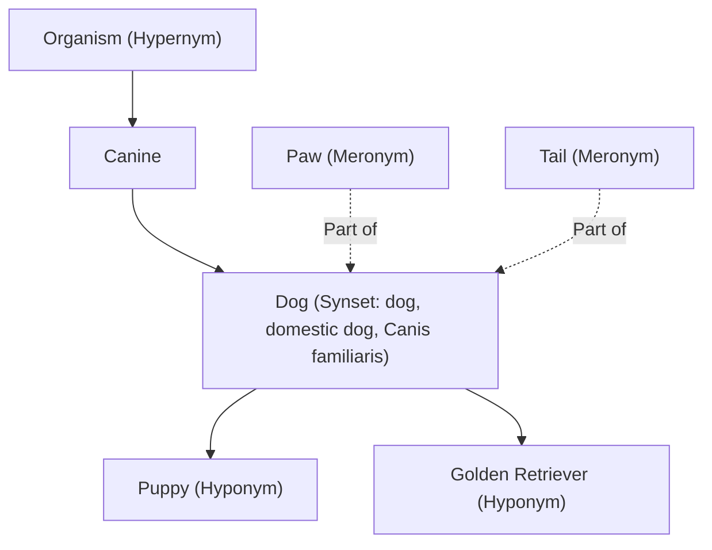

* **Hyponymy and Hypernymy (Is-A Relation):**
  * **Hypernym:** The superordinate generic concept (e.g., *canine* is a hypernym of *dog*).
  * **Hyponym:** The subordinate specific instance (e.g., *dog* is a hyponym of *canine*).
  * Forms a rooted Directed Acyclic Graph (DAG) used to compute taxonomic semantic distance.
* **Meronymy and Holonymy (Part-Whole Relations):**
  * **Meronym:** A constituent part (e.g., *wheel* is a meronym of *car*).
  * **Holonym:** The whole entity (e.g., *car* is a holonym of *wheel*).
* **Antonymy:** Lexical oppositeness between words (e.g., *hot* $\leftrightarrow$ *cold*).
* **Troponymy:** Manner of performing a verb action (e.g., *whisper* is a troponym of *speak*).
* **Entailment:** Actions that logically necessitate another (e.g., *snore* entails *sleep*).

---

##### 2. Indian Language Wordnets (IndoWordNet) & Multilingual Dictionaries (Syllabus Module-IV)
Module-IV explicitly specifies **"Indian Language Wordnets and Multilingual Dictionaries"**:
* **IndoWordNet Framework:** Developed under the leadership of IIT Bombay (CFILT, Prof. Pushpak Bhattacharyya), IndoWordNet is a linked multilingual lexical database covering major Indian languages (Hindi, Marathi, Bengali, Tamil, Telugu, Sanskrit, etc.).
* **The Expansion Approach:**
  * Rather than creating WordNets for each Indian language from scratch (Merge Approach), IndoWordNet links synsets from an existing pivot WordNet (Hindi WordNet / Princeton WordNet).
  * Each synset is assigned a language-independent **Concept ID**. Native language synonyms, glosses, and example sentences are attached to this universal Concept ID.
* **Multilingual Dictionaries & Cross-Lingual WSD:**
  * Shared synset IDs enable direct word-sense alignment across languages, supporting Cross-Lingual WSD and Machine Translation among Indian languages.

---

##### 3. Word2Vec Theory and Applications

#### Overview of Word2Vec
Introduced by Tomas Mikolov et al. at Google (2013), **Word2Vec** is a self-supervised neural framework that learns low-dimensional continuous dense vector embeddings ($\mathbb{R}^d$, typically $d \in [100, 300]$) for words based on the **distributional hypothesis** (*"words that occur in similar contexts have similar meanings"*). 

Word2Vec provides two model architectures:
1. **Continuous Bag of Words (CBOW):** Predicts the target word given its surrounding context words.
2. **Continuous Skip-Gram:** Predicts the surrounding context words given the current target word.

Word vectors capture linear algebraic regularities and semantic analogies:
$$\vec{v}_{\text{King}} - \vec{v}_{\text{Man}} + \vec{v}_{\text{Woman}} \approx \vec{v}_{\text{Queen}}$$

---

#### Key Practical Applications of Word2Vec:

1. **Feature Input for Downstream Deep Learning Architectures:**
   * Used to initialize the embedding lookup layer in LSTMs, CNNs, and Transformers for text classification, sentiment analysis, and machine translation, avoiding random weight initialization.

2. **Measuring Semantic Similarity and Semantic Search:**
   * Replaces exact keyword matching in search engines by computing **Cosine Similarity** between dense vectors:
     $$\text{Sim}(w_1, w_2) = \frac{\vec{v}_{w_1} \cdot \vec{v}_{w_2}}{\|\vec{v}_{w_1}\| \|\vec{v}_{w_2}\|}$$
   * Enables retrieval of semantically equivalent documents even when the query uses synonyms.

3. **Automated Query Expansion in Information Retrieval:**
   * Automatically enriches search queries by appending the top-$k$ nearest neighbor words in embedding space (e.g., expanding *"headache"* to include *"migraine"*, *"cephalea"*).

4. **Recommendation Systems (Item2Vec / Product2Vec):**
   * Treats user browsing sessions, playlists, or purchasing transactions as "sentences" and items/products as "words". Word2Vec learns product embeddings to recommend complementary purchases.

5. **Document Classification and Clustering:**
   * Computes document-level representations by aggregating word vectors (e.g., average pooling or TF-IDF weighted vector averaging), enabling k-means clustering of news articles.

6. **Automated Word Sense & Lexical Analogy Discovery:**
   * Solves analogical reasoning tasks (e.g., *Athens : Greece :: Rome : Italy*) and identifies cultural/linguistic shifts across historical text corpora.

---

##### 4. Summary Comparison: WordNet vs. Word2Vec

| Dimension | WordNet & IndoWordNet | Word2Vec Embeddings |
| :--- | :--- | :--- |
| **Linguistic Paradigm** | **Symbolic / Expert Knowledge Graph:** Hand-curated by lexicographers. | **Statistical / Distributed Semantics:** Unsupervised learning from corpora. |
| **Representation Format** | Discrete nodes connected by labeled semantic relations (Is-A, Part-Of). | Dense continuous vectors in $\mathbb{R}^d$. |
| **Multilingual Handling** | Shared Concept IDs across synsets (IndoWordNet expansion approach). | Multilingual alignment via linear projection matrices. |
| **Handling Polysemy** | Excellent; separate synsets for each distinct word sense. | Conflates multiple senses into a single vector (static embedding limitation). |
| **Interpretability** | 100% human-interpretable explicit ontological graph. | Latent dimensions lack explicit individual semantic labels. |

---

##### 5. Conclusion
WordNet and IndoWordNet provide an expert-curated, symbolic knowledge hierarchy with explicit semantic relationships, while Word2Vec offers scalable continuous vector embeddings derived from large text corpora. Combining symbolic ontologies with neural embeddings provides a strong foundation for semantic NLP.

---
---

```
================================================================================
QUESTION 7
================================================================================
```

### Question 7(a): Write short notes on the following: [7 Marks]
(i) Eliminating Stop words
(ii) Latent Semantic Analysis

#### Answer

---

### (i) Eliminating Stop Words

#### 1. Definition and Concept
In natural language processing, **stop words** are high-frequency, closed-class grammatical words that provide structural cohesion in sentences but carry minimal discriminative or topical information (Jurafsky & Martin, Ch. 23). Examples include articles (*a*, *an*, *the*), prepositions (*in*, *at*, *on*, *by*), conjunctions (*and*, *or*, *but*), and auxiliary verbs (*is*, *was*, *are*, *were*).

**Stop-word elimination** is a standard preprocessing step that filters out these tokens by comparing document text against a pre-compiled stop-word list (such as the standard stop-word lists in NLTK, spaCy, or Lucene).

#### 2. Key Advantages
* **Dimensionality Reduction:** Stop words constitute approximately 30% to 50% of the total tokens in general English text. Removing them significantly reduces the size of inverted index tables and sparse feature matrices (Bag-of-Words, TF-IDF).
* **Enhanced Retrieval Relevance:** High-frequency words appear in nearly all documents, giving them minimal discriminative power ($IDF \approx 0$). Eliminating them prevents search queries from matching irrelevant documents based solely on common words.
* **Computational Efficiency:** Pruning stop words speeds up downstream training, clustering, and classification algorithms while reducing memory usage.

#### 3. Situations Where Stop Words Must NOT Be Eliminated
While beneficial for classical text classification and search indexing, stop-word elimination can degrade performance in certain tasks:
* **Transformer Models & Modern LLMs:** Models like BERT, GPT, and RoBERTa rely on bidirectional multi-head attention across all tokens. Removing stop words destroys grammatical structure and syntactic relationships.
* **Sentiment Analysis with Negation:** Removing words like *"not"*, *"never"*, or *"no"* inverts sentiment polarity (e.g., *"not good"* becomes *"good"*).
* **Phrase Searches & Named Entities:** Eliminating stop words breaks fixed phrases and titles (e.g., *"To be or not to be"* collapses to empty tokens; *"The Who"* or *"Take That"* lose their identity).

---

### (ii) Latent Semantic Analysis (LSA)

#### 1. Definition and Motivation
**Latent Semantic Analysis (LSA)** (also referred to as **Latent Semantic Indexing (LSI)** in information retrieval) is an unsupervised algebraic technique that extracts hidden (latent) conceptual structures and semantic associations from a text collection.

Traditional term-matching models suffer from:
1. **Synonymy:** Different words sharing identical meanings (e.g., *car* and *automobile*).
2. **Polysemy:** A single word having multiple distinct meanings (e.g., *bank* as finance vs. river).

LSA overcomes these limitations by projecting high-dimensional, sparse term-document matrices into a lower-dimensional latent semantic space.

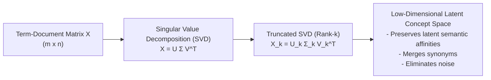

#### 2. Mathematical Formulation via Singular Value Decomposition (SVD)
1. **Construct the Term-Document Matrix $X$ ($m \times n$):**
   * Rows $m$ represent unique vocabulary terms; columns $n$ represent documents.
   * Matrix entries $X_{ij}$ are populated using **TF-IDF** weights rather than raw counts.
2. **Full Singular Value Decomposition:**
   The matrix $X$ is factorized into three matrices:
   $$X = U \ \Sigma \ V^T$$
   * $U$ ($m \times m$): An orthogonal matrix representing term-to-concept relationships.
   * $\Sigma$ ($m \times n$): A diagonal matrix of non-negative singular values sorted in descending order ($\sigma_1 \ge \sigma_2 \ge \dots \ge 0$), representing the variance explained by each latent concept.
   * $V^T$ ($n \times n$): An orthogonal matrix representing concept-to-document relationships.
3. **Truncated SVD (Low-Rank Approximation):**
   LSA retains only the top-$k$ largest singular values ($k \ll \min(m, n)$, typically $k \in [100, 300]$), setting the remaining values to zero:
   $$X_k = U_k \ \Sigma_k \ V_k^T$$
   * According to the **Eckart-Young-Mirsky Theorem**, $X_k$ is the optimal rank-$k$ approximation of matrix $X$ that minimizes the Frobenius norm error.

#### 3. Core Strengths and Limitations

| Strengths of LSA | Limitations of LSA |
| :--- | :--- |
| **Resolves Synonymy:** Maps co-occurring terms (*physician* and *doctor*) to the same latent dimension. | **Computationally Expensive:** SVD factorizations scale at $\mathcal{O}(m n^2)$, making updates difficult for large streaming web corpora. |
| **Noise Filtering:** Discards low-magnitude singular values representing corpus noise. | **Interpretability Issues:** Truncated latent dimensions contain negative numbers, lacking intuitive probabilistic interpretations. |
| **Unsupervised:** Operates purely on term distribution statistics without manual labeling. | **Linearity Assumption:** Assumes linear combinations of concepts; superseded by non-linear neural embeddings (Word2Vec) and probabilistic models (LDA). |

---

##### 4. Conclusion
Stop-word elimination is a heuristic filtering technique for reducing vocabulary noise in classical pipelines, whereas Latent Semantic Analysis is an algebraic dimensionality-reduction technique that uncovers semantic relationships across terms and documents.

---

### Question 7(b): Describe the learning framework architecture to annotate cases with knowledge roles. [7 Marks]

#### Answer

##### 1. Introduction: Case Grammar & Semantic Knowledge Roles
In computational semantics and knowledge engineering (Syllabus Module-IV: *Meaning — Semantic Roles* and prescribed text *James Allen, Natural Language Understanding, Ch. 8*), sentences and problem-solving episodes ("cases") are analyzed using **Case Grammar** (introduced by Charles Fillmore, 1968).

In Case Grammar and Semantic Role Labeling (SRL), verbs or central predicates designate an event, and the noun phrases in the sentence fill deep semantic **cases** or **knowledge roles**:
* **Deep Case / Knowledge Roles:**
  * **Agent:** The deliberate instigator or actor of the event.
  * **Patient / Theme:** The entity undergoing the action or change of state.
  * **Experiencer:** The sentient entity experiencing a perception or psychological state.
  * **Instrument:** The tool or medium used to carry out the event.
  * **Beneficiary:** The entity on whose behalf the action is executed.
  * **Source / Goal / Location:** The spatial or conceptual trajectory of the event.

In applied AI, Case-Based Reasoning (CBR), and medical/technical documentation, these cases are formalized into domain-specific knowledge roles:
$$\text{Case Context} \longrightarrow \langle \text{Symptom/Trigger, Root Cause, Intervention/Action, Outcome} \rangle$$

**Annotating cases with knowledge roles** is the automated machine learning process of segmenting text spans and labeling each span with its correct functional knowledge role.

---

##### 2. The Learning Framework Architecture for Case Role Annotation
The machine learning framework consists of a five-stage pipelined architecture combining linguistic analysis, statistical learning models, and ontological verification:

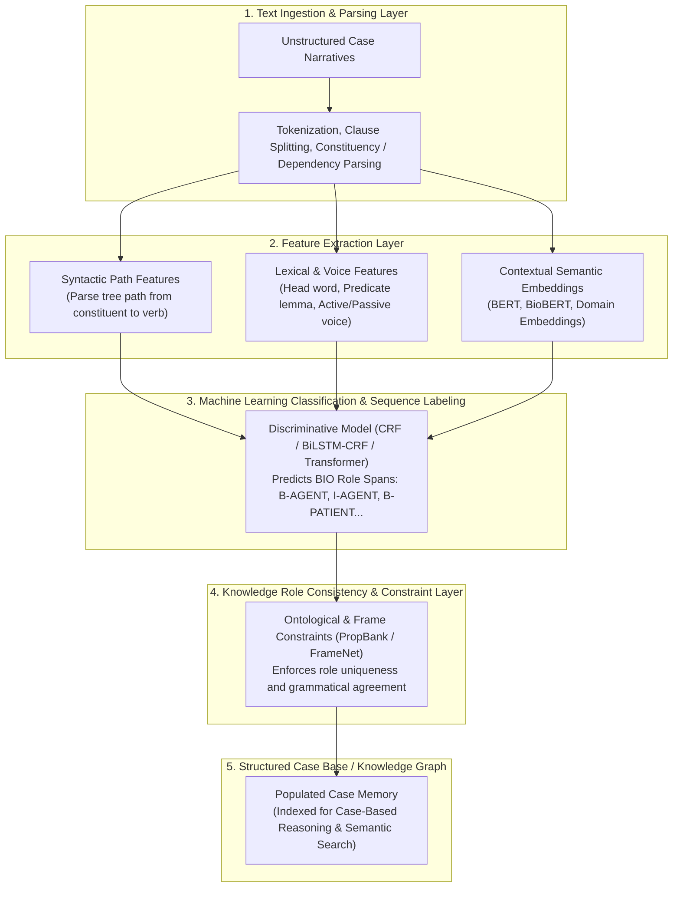

---

##### 3. Detailed Description of the Framework Components

#### 1. Text Ingestion and Syntactic Preprocessing
* Ingests case reports, incident logs, or narrative sentences.
* Executes sentence boundary detection, tokenization, and POS tagging.
* Constructs full syntactic **constituent parse trees** or **dependency graphs** (using parsers like CKY or dependency parsers). The governing predicate (verb) is identified as the semantic anchor.

#### 2. Feature Extraction for Knowledge Role Labeling (Jurafsky & Martin, Ch. 19)
For each candidate constituent phrase in the parse tree, the system extracts a set of specialized features:
* **Syntactic Parse Tree Path:** The grammatical path through the parse tree from the candidate constituent to the governing predicate verb (e.g., $\text{NP} \uparrow \text{S} \downarrow \text{VP} \downarrow \text{VBD}$). This is the single most predictive feature for identifying case roles.
* **Predicate Lemma and Voice:** The root form of the verb and whether the sentence is in **Active** or **Passive** voice (e.g., in active voice, the subject NP is typically `Agent`; in passive voice, it is `Patient`).
* **Head Word and POS:** The syntactic head word of the constituent (e.g., *"hammer"* indicates `Instrument`, *"doctor"* indicates `Agent`).
* **Linear Position:** Whether the phrase appears before or after the predicate verb.
* **Sub-categorization Rule:** The CFG expansion rule of the verb's parent phrase (e.g., $\text{VP} \to \text{VBD NP PP}$).

#### 3. Machine Learning Role Classifier (Discriminative Models)
* **Maximum Entropy Classifiers & CRFs (Syllabus Module-II):**
  * The classifier computes the posterior probability distribution over all permissible case roles given the extracted feature vector:
    $$\hat{r} = \arg\max_{r \in \mathcal{R}} P(r \mid \vec{f}_{\text{path}}, \vec{f}_{\text{head}}, \vec{f}_{\text{predicate}}, \vec{f}_{\text{voice}})$$
* **Sequential Deep Learning (BiLSTM-CRF / Transformers):**
  * Formulates annotation as token-level sequence classification using BIO tagging (`B-Role`, `I-Role`, `O`). The Linear-Chain CRF layer models global transition probabilities between adjacent role tags.

#### 4. Semantic Role Standardization & Constraint Verification
* Evaluates predictions against established linguistic semantic role corpora:
  * **PropBank (Proposition Bank):** Uses coarse numbered roles (`Arg0` = Agent, `Arg1` = Patient/Theme, `Arg2` = Instrument/Beneficiary).
  * **FrameNet:** Connects roles to semantic frames (e.g., the *Cure* frame specifies roles `Healer`, `Affliction`, `Patient`, `Medication`).
* **Consistency Constraints:** Enforces domain axioms (e.g., a simple clause cannot contain multiple distinct `Agent` arguments).

#### 5. Case Base Populating & Application Layer
* Compiles the extracted role spans into structured semantic tuples:
  $$\text{Case Record} = \langle \text{Agent: } X, \text{Action: } V, \text{Patient: } Y, \text{Instrument: } Z, \text{Outcome: } O \rangle$$
* Populates structured enterprise Case Bases for automated **Case-Based Reasoning (CBR)**, decision support systems, and knowledge graphs.

---

##### 4. Concrete Example Walkthrough
Consider the narrative sentence:
$$\text{"The surgeon repaired the damaged artery with a synthetic graft."}$$

* **Predicate Identification:** Verb = *"repaired"* (Active voice).
* **Feature Extraction & Path Traversal:**
  * Constituent `[The surgeon]`: Precedes verb, path $\text{NP} \uparrow \text{S} \downarrow \text{VP} \downarrow \text{V}$, human animate noun $\longrightarrow$ **Role: AGENT**
  * Constituent `[the damaged artery]`: Direct object of VP, path $\text{VP} \downarrow \text{NP}$, undergoes physical change $\longrightarrow$ **Role: PATIENT / THEME**
  * Constituent `[with a synthetic graft]`: Prepositional phrase headed by *"with"*, path $\text{VP} \downarrow \text{PP}$ $\longrightarrow$ **Role: INSTRUMENT**

* **Output Structured Case Frame:**
  ```json
  {
    "Predicate": "repair",
    "Voice": "active",
    "Knowledge_Roles": {
      "Agent": "The surgeon",
      "Patient": "the damaged artery",
      "Instrument": "a synthetic graft"
    }
  }
  ```

---

##### 5. Conclusion
A learning framework for annotating cases with knowledge roles translates unstructured narrative text into structured semantic representations. By extracting syntactic path features and training discriminative classifiers (CRFs or fine-tuned Transformers) against linguistic standards like PropBank and FrameNet, the framework automates case extraction for decision support and Case-Based Reasoning.
