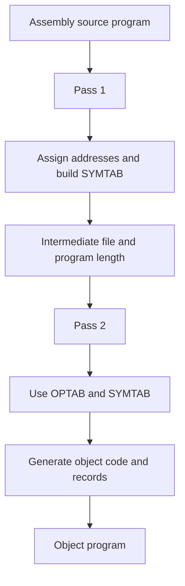
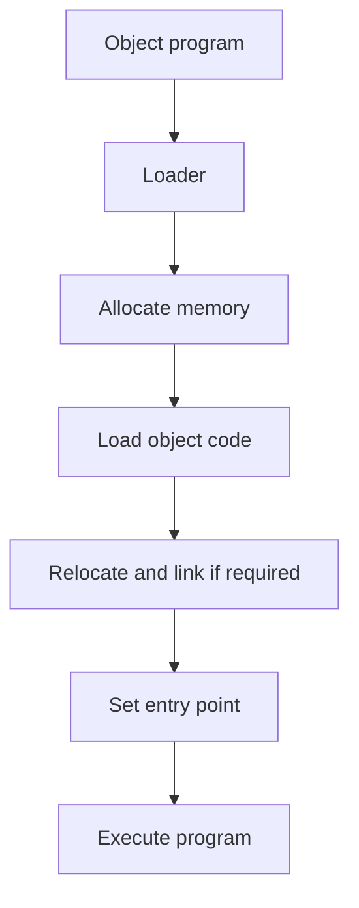
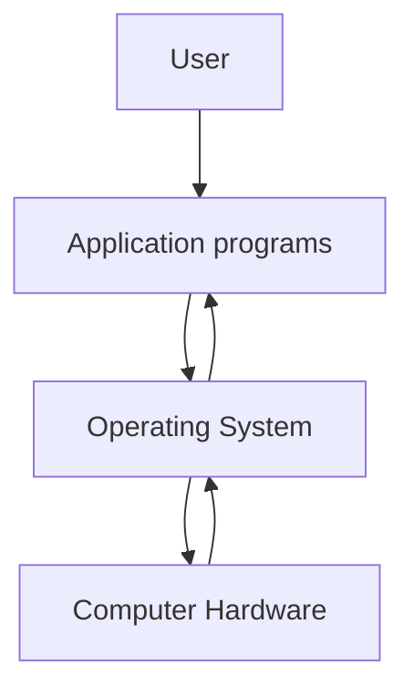
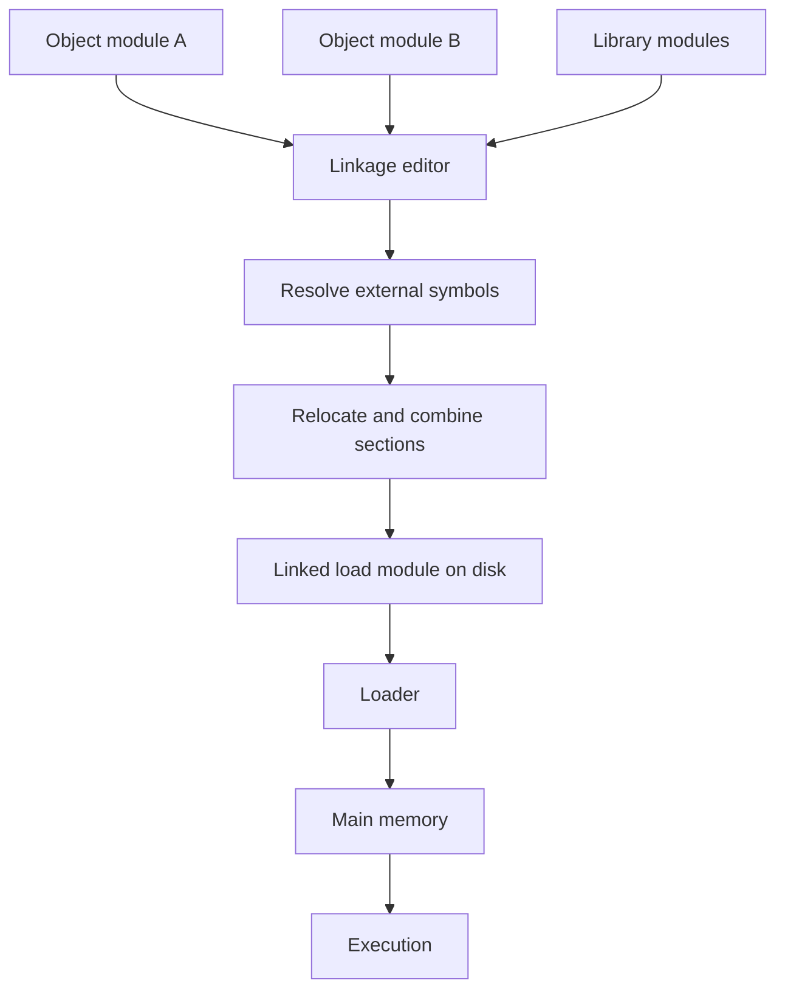
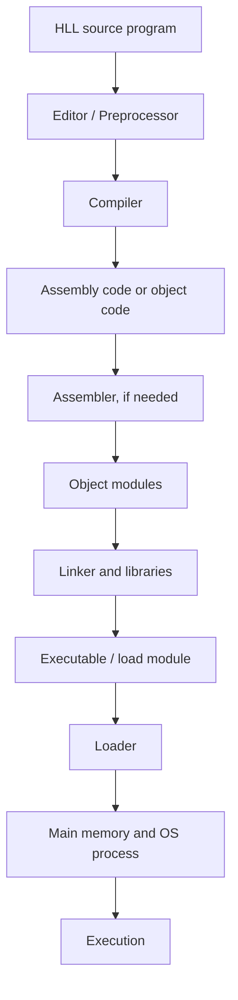

# System Software — Complete PYQ Answers

**Course:** IT611 — System Software  
**Programme:** Computer Science & Engineering / Information Technology  
**Papers covered:** 2025 Annual and 2024 Annual (VB.Tech(6) — System Software)  
**Answer standard:** Approximately 7 marks per sub-question, unless the paper specifies otherwise.

---

## How this answer set uses the syllabus

The primary reference is the **Detailed Syllabus for IT611: System Software**, especially:

- **Module I:** System and application software; assembler, loader, linker, macros and compiler; program development cycle; operating-system evolution and functions; machine structure; registers, data and instructions; evolution of machine language; assembly-language programming.
- **Module II:** Computer architecture and machine instructions; assemblers and their functions/features/design; loaders and linkers; machine-dependent and machine-independent loader features; loader design options; dynamic linking/loading; object files, object formats, code sections, relocation, symbols and relocation, relocatable object formats and ELF.
- **Module III:** Microprocessors; macroprocessor functions, machine-independent features and design options; virtual machines, emulation, interpretation and binary translation.
- **Module IV:** Pascal P-code VM, object-oriented VMs, Java VM architecture, Common Language Infrastructure, dynamic class loading and advanced system-software features.

**Syllabus-document caution:** The supplied syllabus page labels the course IT611 System Software, but its opening objective mentions “Phase transformations,” which is unrelated to this course. Some listed course outcomes are also broader than the detailed module descriptions. Therefore, this answer set uses the detailed IT611 modules and the listed System Software, Linkers & Loaders, and Virtual Machines textbooks as the primary guide. The exam questions themselves are retained even where a topic (for example, RISC vs CISC) is not explicitly named in the detailed module list.

## Examination coverage and question policy

The supplied PYQ PDF contains:

- **2025 Annual:** 7 main questions, 14 sub-questions (PDF pages 1–2).
- **2024 Annual:** 8 main questions, 16 sub-questions (PDF pages 3–4).

All **30 sub-questions** are answered below. The paper instruction “Answer any five questions” is for examination candidates; it does not limit this preparation set. No question, sub-question, or internal choice appearing in the supplied papers has been intentionally omitted.

---

# Part A — 2025 Annual Examination

## Question 1(a): Differentiate between application software and system software. Discuss the roles of any four system software.

### Answer

**System software** is a set of programs that manages computer hardware and provides a platform and common services for application programs. **Application software** is designed to help users perform particular tasks such as writing documents, preparing accounts, browsing the web or editing images.

### Difference between system software and application software

| Basis | System software | Application software |
|---|---|---|
| Main purpose | Operates and controls the computer system and supports other programs. | Performs a task required by the user. |
| Relationship with hardware | Works close to the hardware and manages system resources. | Normally uses services provided by system software. |
| Dependency | Provides the environment needed by most applications. | Usually depends on an operating system and runtime services. |
| Execution | Often starts during booting or runs as a background/system service. | Runs when the user or another program starts it. |
| Examples | Operating system, assembler, compiler, loader, linker and macro processor. | Word processor, spreadsheet, browser, media player and accounting software. |

### Roles of four system-software components

1. **Operating system:** Manages the CPU, main memory, files and input/output devices. It provides a user interface and standard services through which programs request system resources.
2. **Assembler:** Translates an assembly-language program into machine/object code. It converts mnemonics into operation codes, evaluates symbols and addresses, and reports errors.
3. **Compiler:** Translates a high-level-language program into a lower-level form, commonly assembly or object code. It checks syntax and performs analysis and code generation.
4. **Loader and linker:** A linker combines object modules and libraries, resolves external symbols and prepares a load module. A loader places the program in memory, performs required relocation and transfers control to it.

A **macro processor** is another system-software component. It expands a macro call into the sequence of source statements represented by the macro definition.

**Conclusion:** System software operates and supports the computer system, while application software uses those facilities to solve user problems.

---

## Question 1(b): Differentiate between RISC and CISC machines with suitable examples.

### Answer

**RISC (Reduced Instruction Set Computer)** and **CISC (Complex Instruction Set Computer)** are two approaches to processor instruction-set design. RISC generally uses a relatively small set of simple instructions, whereas CISC provides a richer set of instructions, some of which perform complex operations.

| Basis | RISC | CISC |
|---|---|---|
| Instruction set | Comparatively small and simple. | Comparatively large and includes complex instructions. |
| Instruction format | Often uses fixed-length or a small number of regular formats. | Often supports several instruction lengths and formats. |
| Addressing modes | Usually fewer addressing modes. | Usually more addressing modes. |
| Memory access | Commonly follows a load/store design: arithmetic operates mainly on registers. | Some instructions can operate directly on memory operands. |
| Control design | Often suitable for simpler, regular control logic. | Complex instructions may require more complex decoding or microcode. |
| Compiler role | Compiler may generate several simple instructions for one high-level operation. | A single instruction may perform a more complex operation. |
| Examples | ARM and RISC-V are examples of RISC-style instruction-set architectures. | x86 is traditionally classified as CISC. |

### Example

In a load/store RISC style, adding two values stored in memory may require loading them into registers, adding the register values, and storing the result:

```text
LOAD  R1, A
LOAD  R2, B
ADD   R3, R1, R2
STORE C, R3
```

A CISC instruction set may provide an instruction capable of combining a memory operand with an arithmetic operation, depending on the particular architecture.

### Advantages and limitations

- **RISC:** Regular instructions can simplify pipelining and decoding. However, a task may require more instructions, and code size can increase in some cases.
- **CISC:** Complex instructions can make some programs more compact and can provide rich addressing facilities. However, instruction decoding and implementation can be more complex.

**Important note:** Modern processors often combine ideas from both approaches. Therefore, RISC and CISC are broad design categories, not absolute descriptions of every internal implementation.

**Syllabus note:** The IT611 detailed syllabus includes machine structure and machine instructions but does not explicitly list RISC/CISC. This answer is included because it is directly asked in the 2025 examination paper.

---

## Question 2(a): Define and explain assembly-language format with suitable examples.

### Answer

**Assembly language** is a low-level programming language that represents machine instructions through mnemonic operation codes and symbolic names instead of writing binary instruction bits directly. An **assembler** translates an assembly-language program into machine/object code.

### General format of an assembly statement

A typical assembly statement has the following fields:

```text
[LABEL]    [OPERATION / MNEMONIC]    [OPERAND(S)]    [COMMENT]
```

1. **Label:** An optional symbolic name for the address of the instruction or data item. Other instructions can refer to this name.
2. **Operation code (opcode):** Specifies the operation to be performed, such as `LDA`, `ADD`, `SUB`, `STA` or an assembler directive such as `WORD`.
3. **Operand:** Specifies registers, constants, symbols or memory locations required by the operation.
4. **Comment:** Optional explanatory text for the programmer. It is not translated into an executable operation.

### Example in SIC-style assembly language

```asm
. Program begins at address 1000
COPY    START   1000
. Load ALPHA into the accumulator, add ONE, and store the result in BETA
FIRST   LDA     ALPHA
        ADD     ONE
        STA     BETA
ALPHA   WORD    5
ONE     WORD    1
BETA    RESW    1
        END     FIRST
```

In this example, `FIRST`, `ALPHA`, `ONE` and `BETA` are labels; `LDA`, `ADD` and `STA` are machine mnemonics; `START`, `WORD`, `RESW` and `END` are assembler directives.

### Common SIC assembler directives

| Directive | Purpose |
|---|---|
| `START` | Specifies the starting address of the program. |
| `END` | Marks the end of the source program and may identify the first executable instruction. |
| `BYTE` | Defines a byte constant. |
| `WORD` | Defines a word-sized constant. |
| `RESB` | Reserves a specified number of bytes. |
| `RESW` | Reserves a specified number of words. |

Directives guide the assembler; they are not normally translated into CPU instructions.

**Conclusion:** The label–opcode–operand–comment format makes low-level programs easier to write, read, modify and translate into machine code.

---

## Question 2(b): Design a two-pass assembler, explaining its working principle.

### Answer

A **two-pass assembler** translates an assembly-language program into object code by scanning the source program twice. Pass 1 assigns addresses and builds a symbol table. Pass 2 uses that information to generate object code and report unresolved symbols.

### Main data structures

- **OPTAB:** Stores machine operation mnemonics and their machine opcodes/instruction information.
- **SYMTAB:** Stores each label and its assigned address.
- **Intermediate file:** Stores source statements together with addresses and other information prepared by Pass 1.
- **LOCCTR:** Location counter that keeps the address of the statement currently being processed.

### Working of Pass 1

1. Read the `START` statement, if present, and initialize `LOCCTR` with the specified starting address.
2. Read each source statement and assign the current `LOCCTR` to it.
3. If the statement contains a label, enter the label and its address in `SYMTAB`. Report a duplicate label if it already exists.
4. If the opcode is a machine instruction, increase `LOCCTR` by the instruction length.
5. If it is a storage directive such as `WORD`, `RESW`, `BYTE` or `RESB`, update `LOCCTR` according to the amount of storage defined or reserved.
6. Process directives such as `EQU`, `ORG`, `BASE` and `LTORG` according to the assembler's rules.
7. Write the statement and its address to the intermediate file.
8. At the end, calculate program length from the starting and final location-counter values.

### Working of Pass 2

1. Read the intermediate file and initialize the object-program records.
2. Look up each machine mnemonic in `OPTAB` to obtain its opcode.
3. Resolve symbolic operands using `SYMTAB` and calculate the required address or displacement.
4. Generate the object code for each instruction and data constant.
5. Group object code into text records, respecting record-length and reserved-storage gaps.
6. Generate header, text and end records in the required object format. Report undefined symbols and other errors.

### Flow of operation



**Advantage:** Forward references can be handled because Pass 1 records symbol addresses before Pass 2 generates object code. The main cost is that the source information must be processed in two passes and intermediate information must be stored.

---

## Question 3(a): What is a loader? Explain the working principle of a loader.

### Answer

A **loader** is system software that places an object program into main memory and prepares it for execution. Depending on its design, it may also perform relocation and linking.

### Basic functions of a loader

1. **Allocation:** Determines or uses the memory area in which the program will be placed.
2. **Loading:** Copies the machine-code instructions and data from the object file into the allocated memory locations.
3. **Relocation:** Adjusts address-dependent parts of the program when it is loaded at an address different from the one assumed during translation.
4. **Linking:** Resolves references between separately compiled or assembled object modules and required library routines, when supported by the loader.
5. **Transfer of control:** Sets the execution environment as required and transfers control to the program's entry point.

### Working principle

1. The loader receives an object program and determines its loading address.
2. It reads the object-program records and identifies the program's length and entry information.
3. It allocates memory for the program.
4. It copies each object-code record into its specified memory location.
5. If relocation is needed, it modifies address fields using relocation information.
6. If external references are to be resolved by the loader, it searches the required definitions and updates those references.
7. After all required preparation, it transfers control to the execution address.



A simple **absolute loader** only loads code at the addresses recorded in the object program. A **relocating loader** can adjust addresses, while a **direct-linking loader** can also resolve external references.

**Conclusion:** The loader connects translation and execution by placing the program in memory and preparing its addresses and references.

---

## Question 3(b): Explain the relocating loader and direct-linking loader.

### Answer

A **relocating loader** adjusts address-sensitive parts of an object program so that it can be loaded at a memory location different from the address assumed when it was assembled. A **direct-linking loader** loads multiple object modules, resolves external symbols between them, performs relocation and links them directly in memory.

### 1. Relocating loader

If a program was assembled assuming a starting address `1000` but is loaded at `4000`, the relocation factor is:

\[
\text{Relocation factor} = 4000 - 1000 = 3000
\]

Where the object program contains an address that must be relocated, the loader adds the relocation factor to that address. Relocation information (such as relocation bits or modification records) tells the loader which fields require adjustment. Not every numeric constant is relocated; only address-dependent fields are changed.

**Steps:**
1. Determine the actual loading address.
2. Calculate the relocation factor.
3. Load object code into memory.
4. Identify address fields marked for relocation.
5. Add the relocation factor to those fields.
6. Transfer control to the relocated entry point.

### 2. Direct-linking loader

A direct-linking loader loads separately assembled modules and resolves references between them while loading.

It commonly uses an **External Symbol Table (ESTAB)** containing control-section names and externally defined symbols with their assigned addresses.

**Pass 1:** Assign addresses to control sections, enter control-section and external symbol definitions in ESTAB, and calculate the total length.  
**Pass 2:** Load text records, resolve external references using ESTAB, apply modification records, and transfer control to the specified execution address.

### Difference

| Relocating loader | Direct-linking loader |
|---|---|
| Main task is adjusting address-dependent fields. | Loads and links multiple object modules. |
| May work with a single relocatable object program. | Uses external definitions and references among control sections. |
| Needs relocation information. | Needs relocation information and external-symbol information. |
| Does not necessarily resolve external symbols. | Resolves external references during loading. |

**Conclusion:** Relocation makes a program usable at a selected memory address; direct linking additionally connects separately translated modules.

---

## Question 4(a): Write short notes on (i) Mnemonics (ii) DLL.

### Answer

### (i) Mnemonics

A **mnemonic** is a short symbolic name used to represent a machine instruction or operation in assembly language. It makes a program easier for humans to read and write than a sequence of binary bits.

Examples:

| Mnemonic | General meaning |
|---|---|
| `ADD` | Add values. |
| `SUB` | Subtract a value. |
| `LDA` | Load a value into an accumulator (SIC example). |
| `STA` | Store an accumulator value (SIC example). |
| `J` | Jump to another instruction (architecture-dependent). |

The assembler looks up each mnemonic in its operation table (OPTAB) and translates it into the corresponding machine opcode. The exact meaning and encoding depend on the processor architecture.

**Advantages:** Mnemonics improve readability, reduce errors caused by writing binary codes manually, and make assembly programs easier to maintain.

### (ii) DLL (Dynamic Link Library)

A **Dynamic Link Library (DLL)** is a library file containing functions, procedures or resources that can be used by one or more application programs. In systems such as Windows, DLLs are commonly loaded and linked when a program starts or when a required function is first used.

**Working:**
1. A program is built with references to functions exported by a DLL.
2. At load time or run time, the operating system's loader locates the required DLL.
3. The loader maps the library into the process address space and resolves function references.
4. The program calls the imported functions through the resolved addresses.

**Advantages:**
- Common code can be shared by several programs, reducing duplication.
- A library can sometimes be updated independently of the application.
- Large programs can load optional library components only when needed.

**Limitations:** A missing or incompatible DLL can prevent a program from running; version conflicts and dependency problems must be managed. A DLL is a platform-specific example of dynamic-library technology; Unix-like systems commonly use shared objects such as `.so` files.

---

## Question 4(b): Differentiate between assembly language and machine language.

### Answer

**Machine language** is the binary-coded instruction language directly understood by a processor. **Assembly language** is a symbolic representation of machine instructions using mnemonics, labels and operands. An assembler translates assembly language into machine code.

| Basis | Assembly language | Machine language |
|---|---|---|
| Representation | Uses mnemonics, labels and symbolic operands. | Uses binary bit patterns (often displayed in hexadecimal). |
| Readability | Comparatively easier for humans to read. | Difficult for humans to read and write. |
| Translation | Requires an assembler. | Executed directly by the processor; no assembler translation is required at execution time. |
| Addressing | Can use symbolic labels. | Uses encoded register and address fields. |
| Error handling | Assembler can detect syntax and symbol-related errors. | Manually prepared bit patterns are difficult to check and debug. |
| Portability | Depends on the target instruction set and assembler. | Specific to a processor instruction set. |
| Example | `LDA VALUE` | The binary encoding of the corresponding load instruction and address. |

### Example

Assembly statement:

```asm
LDA  VALUE
```

The assembler looks up the opcode for `LDA`, resolves the address represented by `VALUE`, and produces the appropriate machine instruction. The actual binary pattern differs between architectures.

**Conclusion:** Machine language is the processor's executable instruction representation, whereas assembly language is its human-readable symbolic form.

---

## Question 5(a): Compare a single-pass assembler and a two-pass assembler.

### Answer

A **single-pass assembler** scans the source program once and attempts to generate object code during that scan. A **two-pass assembler** scans the source twice: the first pass assigns addresses and builds the symbol table, and the second pass generates object code.

| Basis | Single-pass assembler | Two-pass assembler |
|---|---|---|
| Number of scans | Normally one scan. | Two scans. |
| Symbol handling | Forward references require special handling, backpatching or restrictions. | Forward references are handled using the symbol table built in Pass 1. |
| Main data structures | May use a symbol table and a list of unresolved references. | Uses OPTAB, SYMTAB and usually an intermediate file. |
| Object-code generation | Generated while reading statements. | Mainly generated during Pass 2. |
| Processing time | Can be faster because the source is scanned once. | Requires a second scan and may use intermediate storage. |
| Design | Can be more complicated when forward references are allowed. | Has a clear separation between address assignment and code generation. |
| Suitability | Useful where the language or design limits forward references or supports backpatching. | Suitable for general assembly programs with forward references. |

### Example of a forward reference

```asm
        J     LOOP
        ...
LOOP    ADD   VALUE
```

When the assembler reads `J LOOP`, the address of `LOOP` may not yet be known. A single-pass assembler must retain the unresolved reference and fix it later, or impose restrictions. A two-pass assembler records the address of `LOOP` in Pass 1 and uses it in Pass 2.

**Conclusion:** A single-pass assembler can reduce scanning time but needs a mechanism for unresolved symbols. A two-pass assembler is easier to organize for general programs and handles forward references systematically.

---

## Question 5(b): Discuss the significance of a virtual machine.

### Answer

A **virtual machine (VM)** is a software-created execution environment that behaves like a computer system by providing a set of machine resources or an instruction set to programs. A VM can emulate a complete hardware platform or provide an abstract machine for a particular programming language.

### Significance of a virtual machine

1. **Platform independence:** A program written for a standard VM can run on different physical systems if a compatible VM implementation is available. Java bytecode running on a Java Virtual Machine (JVM) is an example.
2. **Isolation:** A VM can separate one execution environment from another. A fault or change in one guest environment can be prevented from directly affecting other environments, subject to the VM's security design.
3. **Resource sharing:** Several virtual machines can share one physical computer while receiving separately managed CPU, memory and storage resources.
4. **Testing and development:** Developers can test software in controlled environments without requiring a separate physical computer for every configuration.
5. **Legacy support:** Emulation can allow software designed for an older instruction set or machine to run on a different host system.
6. **Management and portability:** Virtual machine images can be copied, backed up and deployed on compatible hosts.

### Types

- **System virtual machine:** Provides a virtual hardware platform on which a guest operating system runs.
- **Process virtual machine:** Provides an execution environment for a single program or language, such as the JVM or a Pascal P-code machine.

**Limitations:** Virtualization may add performance overhead and requires careful management of resources and security.

**Conclusion:** VMs improve portability, isolation, resource utilization and compatibility, and are an important part of modern system software.

---

## Question 6(a): Elaborate the role of an operating system between hardware and the user.

### Answer

An **operating system (OS)** is system software that acts as an intermediary between computer hardware and users or application programs. It manages hardware resources and provides convenient services so that users do not need to control hardware directly.

### Role of the operating system



1. **User interface:** Provides a command-line interface or graphical user interface through which users interact with the computer.
2. **Hardware abstraction:** Hides many hardware details and offers standard operations such as opening a file, reading data or creating a process.
3. **CPU management:** Schedules processes and allocates processor time so that multiple tasks can make progress.
4. **Memory management:** Tracks memory usage, allocates and releases memory, and provides protection between processes.
5. **Device management:** Controls input/output devices through device drivers and coordinates operations such as keyboard input, display output and disk access.
6. **File management:** Organizes files and directories and controls file creation, deletion, storage and access permissions.
7. **Protection and security:** Authenticates users where required and controls access to system resources.

### Example

When a user saves a document, the application requests a file operation from the OS. The OS checks permissions, communicates with the file system and storage device, and reports the result to the application.

**Conclusion:** The OS provides a convenient and controlled bridge between users, applications and the underlying hardware.

---

## Question 6(b): Describe the functions of an operating system.

### Answer

An **operating system** manages computer hardware and provides services to application programs. Its main functions are as follows:

1. **Process management:** Creates, schedules and terminates processes; performs context switching; and coordinates process synchronization.
2. **Memory management:** Keeps track of used and free memory, allocates memory to processes and releases it when no longer required. It may support virtual memory.
3. **File-system management:** Creates and deletes files and directories, organizes storage, maintains metadata and controls access.
4. **Device and I/O management:** Controls input/output devices through drivers, coordinates I/O requests and uses buffering or caching where appropriate.
5. **Secondary-storage management:** Manages disk space, free-space information, storage allocation and disk scheduling where applicable.
6. **Security and protection:** Protects data and resources through authentication, permissions and access-control mechanisms.
7. **User interface and system services:** Provides command-line or graphical interfaces and system calls for applications.
8. **Error detection and handling:** Detects hardware and software errors and takes appropriate corrective action or reports failures.
9. **Resource allocation and accounting:** Allocates CPU, memory and devices among users/processes and may record resource usage.

**Conclusion:** The OS makes the computer convenient, efficient and secure by coordinating all major hardware and software resources.

---

## Question 7(a): Define a macro. Illustrate the major functions of a macro processor.

### Answer

A **macro** is a named sequence of source statements that can be invoked by a macro call. A **macro processor** recognizes the call and expands it by substituting actual arguments for formal parameters and inserting the resulting statements into the source program.

### Major functions of a macro processor

1. **Macro definition processing:** Recognizes macro definitions, identifies the macro name and parameters, and stores the body for later use.
2. **Macro-call recognition:** Detects a statement whose operation field is a defined macro name.
3. **Argument association:** Matches actual arguments in a macro call with the formal parameters in the definition.
4. **Parameter substitution:** Replaces formal parameters in the stored body with the corresponding actual arguments.
5. **Macro expansion:** Inserts the expanded statements into the output stream in place of the macro call.
6. **Conditional expansion:** Supports selection or repetition of macro statements based on parameter values or conditions, if the macro language provides such features.
7. **Nested or recursive macro handling:** Manages calls to other macros from within a macro body, subject to the processor's supported rules.
8. **Error detection:** Reports undefined macro calls, missing or extra arguments and invalid definitions.

### Example

Macro definition:

```asm
INCR    MACRO   &ARG
        LDA     &ARG
        ADD     ONE
        STA     &ARG
        MEND
```

Macro call:

```asm
        INCR    COUNT
```

Expanded statements:

```asm
        LDA     COUNT
        ADD     ONE
        STA     COUNT
```

**Conclusion:** A macro processor reduces repetitive coding and improves consistency by expanding reusable statement patterns.

---

## Question 7(b): Explain the roles of DEFTAB, NAMTAB and ARGTAB in a macro processor.

### Answer

A macro processor commonly uses three important tables: **DEFTAB, NAMTAB and ARGTAB**. They store macro definitions, locate definitions and hold arguments for a particular macro call.

| Table | Full form / purpose | Information stored |
|---|---|---|
| **DEFTAB** | Definition Table | The body of each macro definition, usually with formal parameters represented in a form convenient for substitution. |
| **NAMTAB** | Name Table | Macro names and pointers or indices identifying the corresponding definition in DEFTAB. It may also record the definition's end position. |
| **ARGTAB** | Argument Table | Actual argument values supplied in a particular macro call, arranged so that formal parameters can be replaced during expansion. |

### Working together

Suppose the macro is defined as:

```asm
INCR    MACRO   &X
        LDA     &X
        ADD     ONE
        STA     &X
        MEND
```

1. The macro processor stores the macro body in **DEFTAB**. References to `&X` are represented so they can be substituted later.
2. **NAMTAB** stores the macro name `INCR` and the location of its definition in DEFTAB.
3. When it reads `INCR COUNT`, it places `COUNT` in **ARGTAB** as the actual value for `&X`.
4. It follows the NAMTAB pointer, reads the body from DEFTAB and substitutes `COUNT` for `&X`.
5. The expanded statements are sent to the output.

```text
NAMTAB  --locates-->  DEFTAB (macro body)
                         |
ARGTAB (actual values) --+--> parameter substitution --> expansion
```

**Conclusion:** NAMTAB finds a macro definition, DEFTAB stores it, and ARGTAB supplies the values needed to expand a particular macro call.

---

# Part B — 2024 Annual Examination

## Question 1(a): Explain the macro-processor algorithm.

### Answer

A **macro processor** processes macro definitions and expands macro calls into ordinary source statements. A common textbook design uses two logical stages: one stage records macro definitions; the expansion stage recognizes calls and generates substituted statements. Some implementations combine or organize these stages differently.

### Stage 1: Process macro definitions

1. Read the source program statement by statement.
2. When a `MACRO` definition begins, identify the macro name and its formal parameters.
3. Enter the macro name and pointers to its definition in **NAMTAB**.
4. Store the macro body in **DEFTAB**. Replace formal parameters with positional or internal parameter references if the processor uses that representation.
5. Continue until the matching `MEND` is found and record the end of the definition.
6. Continue scanning the source for other macro definitions.

### Stage 2: Expand macro calls

1. Read the program after macro definitions have been processed.
2. If the operation field is not a macro name, copy the statement to the output.
3. If it is a macro call, search NAMTAB to find the macro definition.
4. Separate the actual arguments and enter them in ARGTAB in the order corresponding to the formal parameters.
5. Read the macro body from DEFTAB.
6. Substitute each formal parameter with its actual argument.
7. Output the expanded statements. Process nested macro calls if supported.
8. Report errors such as undefined macro names or incorrect argument counts.

### Example

Definition:

```asm
ZERO_REG MACRO   &REG
        CLEAR   &REG
        MEND
```

Call:

```asm
        ZERO_REG A
```

The argument `A` is entered in ARGTAB and substituted for `&REG` in the stored body.

**Conclusion:** The algorithm stores definitions for reuse and expands each call through argument association and parameter substitution.

---

## Question 1(b): What is dynamic linking? Explain with an example. What are assembler directives? List any five assembler directives in SIC.

### Answer

### Dynamic linking

**Dynamic linking** is the process of connecting a program with library routines at load time or run time rather than copying all required library code permanently into the executable at static-link time.

**Working:**
1. The program is compiled/assembled with references to external library functions.
2. The executable records information identifying the required shared library and imported symbols.
3. When the program starts, or when a function is first required, the dynamic linker/loader locates the library.
4. The library is mapped into memory and external references are resolved to the correct function addresses.
5. The program calls the resolved function.

**Example:** A Windows program may use functions from a DLL such as a system DLL. A Unix-like program may use functions from a shared object such as `libc.so`.

**Advantages:** Shared code can reduce executable duplication and memory usage; libraries can be updated independently when interfaces remain compatible. **Limitations:** Missing libraries or incompatible versions can cause loading failures.

### Assembler directives

Assembler directives (also called **pseudo-operations**) are commands to the assembler that control assembly, define data, reserve storage or set program information. They usually do not correspond to executable CPU instructions.

Five SIC directives are:

| Directive | Function |
|---|---|
| `START` | Gives the starting address of the program. |
| `END` | Marks the end of the source program and may specify the first executable instruction. |
| `BYTE` | Defines a byte constant. |
| `WORD` | Defines a word constant. |
| `RESB` | Reserves a specified number of bytes. |

Other common SIC directives include `RESW` (reserve words) and `EQU` (assign a value to a symbol).

---

## Question 2(a): Differentiate between linking loaders and linkage editors.

### Answer

A **linking loader** performs linking and loading together whenever the program is loaded. A **linkage editor** performs linking before execution and produces a linked load module that can be stored and loaded later.

| Basis | Linking loader | Linkage editor |
|---|---|---|
| When linking occurs | At load time. | Before normal program execution, as a separate link-edit step. |
| Output | Usually places the linked program directly in memory. | Produces a linked load module on secondary storage. |
| Repeated execution | Linking work may be repeated on each load. | The saved linked module can be loaded repeatedly without repeating the full link-edit step. |
| Storage | Does not necessarily create a permanent linked executable. | Creates a reusable linked module. |
| Update of modules | New module versions are resolved during the next load. | The linkage editor must be run again when the linked module needs updating. |
| Flexibility | Convenient when modules or addresses need to be resolved at load time. | Useful when the same linked program is executed repeatedly. |

### Working of a linkage editor

1. Accepts object modules and required library modules.
2. Searches for external definitions and references.
3. Assigns addresses to control sections and resolves external symbols.
4. Performs required relocation and modifies address-dependent fields.
5. Produces a linked load module on disk.
6. Later, a loader loads this module into memory for execution.

**Conclusion:** A linking loader links each time it loads, whereas a linkage editor saves the result of linking so it can be loaded again later.

---

## Question 2(b): What do you mean by system programming? Explain different types of system software in brief.

### Answer

**System programming** is the activity of developing programs that control, manage or support the operation of a computer system. System programs work close to the hardware and provide services used by application programs and users.

### Types of system software

1. **Operating system:** Manages processor time, memory, files and I/O devices, and provides services to users and applications.
2. **Assembler:** Converts assembly-language instructions and symbolic addresses into machine/object code.
3. **Compiler:** Translates high-level-language source code into a lower-level form and reports programming errors.
4. **Interpreter:** Executes a program by translating or evaluating its statements during execution rather than first producing a complete native object program.
5. **Macro processor:** Expands macro calls by substituting actual arguments into stored macro definitions.
6. **Linker:** Combines object modules and libraries, resolves external references and prepares a linked program.
7. **Loader:** Loads a program into memory, carries out relocation/linking as required, and starts execution.
8. **Utilities and development tools:** Editors, debuggers, file-management tools and diagnostic programs help users develop, test and maintain programs.

### System software and application software

System software manages the computer and provides a platform; application software performs user-oriented tasks. For example, an operating system is system software, while a spreadsheet program is application software.

**Conclusion:** System programming produces the basic software infrastructure that allows application programs to be developed and executed efficiently.

---

## Question 3(a): What is a literal? How is a literal handled by an assembler? Explain the algorithm for an absolute loader.

### Answer

### Literal

A **literal** is a constant written directly in an assembly-language operand, commonly using a notation such as `=C'EOF'` or `=X'F1'` in SIC/SIC-XE-style assembly. Instead of requiring the programmer to define a separate labelled constant, the assembler stores the literal in a literal pool and assigns it an address.

### Handling of literals by an assembler

1. When the assembler encounters a literal operand, it checks whether the literal is already recorded in the literal table (**LITTAB**).
2. If it is new, the assembler enters the literal, its length and an address field to be assigned later.
3. Literal values are collected until a literal-pool directive such as `LTORG` is encountered, or until the end of the program.
4. The assembler assigns addresses to the literals in the current pool and updates the location counter.
5. It generates the required constant bytes in the object program.
6. When an instruction refers to a literal, the assembler uses the assigned literal address.

A **POOLTAB** may be used to identify the beginning of each literal pool. `LTORG` forces the current pool to be placed at that point; `END` causes any remaining literals to be assigned.

### Absolute-loader algorithm

An **absolute loader** loads object code into the exact memory addresses specified in the object program. It does not relocate addresses or resolve external references.

For a simple SIC-style object program:

1. Read the Header (`H`) record to obtain the program name, starting address and length.
2. Read each Text (`T`) record.
3. Take the address given in the Text record and copy its object-code bytes into those exact memory locations.
4. Continue until the End (`E`) record is reached.
5. Obtain the execution address from the End record, or use the specified starting address when appropriate.
6. Transfer control to that address.

**Limitation:** The program must be loaded at the address for which it was assembled. If it is loaded elsewhere, address fields may be incorrect because an absolute loader does not perform relocation.

---

## Question 3(b): List the basic functions of assemblers with proper examples.

### Answer

An **assembler** translates an assembly-language source program into machine/object code. Its basic functions include:

1. **Mnemonic translation:** Converts operation mnemonics into machine opcodes. Example: `LDA` is converted to the opcode defined by the target instruction set.
2. **Symbol definition and address assignment:** Assigns addresses to labels and stores them in SYMTAB. Example: the label `LOOP` is associated with the address of its instruction.
3. **Symbol resolution:** Replaces symbolic operands with the corresponding addresses or encoded references. Example: `J LOOP` uses the address assigned to `LOOP`.
4. **Processing assembler directives:** Handles `START`, `END`, `BYTE`, `WORD`, `RESB`, `RESW`, `EQU` and other directives. For example, `RESW 3` reserves three words.
5. **Constant and literal handling:** Converts constants into object bytes and assigns addresses to literals through LITTAB and literal pools.
6. **Address calculation and relocation information:** Calculates instruction addresses and records information needed for relocation when the object format supports it.
7. **Object-program generation:** Produces object records containing program information, code and execution information.
8. **Error detection:** Reports errors such as invalid mnemonics, duplicate symbols, undefined symbols and invalid operands.

### Example

```asm
FIRST   LDA     VALUE
        ADD     ONE
        STA     RESULT
VALUE   WORD    5
ONE     WORD    1
RESULT  RESW    1
```

The assembler assigns addresses to `FIRST`, `VALUE`, `ONE` and `RESULT`, translates `LDA`, `ADD` and `STA` through OPTAB, resolves the symbols through SYMTAB and produces object code.

**Conclusion:** The assembler performs translation, symbol handling, address calculation, directive processing, object-code generation and error reporting.

---

## Question 4(a): How are unique labels generated in a macro expansion?

### Answer

When a macro containing a label is expanded more than once, the same label may appear repeatedly in the generated program. This can cause duplicate-label errors or make branches refer to the wrong occurrence. A macro processor therefore needs a way to generate **unique labels** for each expansion.

### Method

1. The macro definition uses a local-label convention or a special macro-time variable for labels that must be unique.
2. Each time the macro is expanded, the processor maintains or increments an expansion counter.
3. It combines the local label with the counter or a generated suffix to create a new label.
4. All references to that local label within the same expansion are changed consistently.
5. A later expansion receives a different suffix, so it cannot conflict with the earlier expansion.

### Example (illustrative)

Macro body:

```asm
TEST    MACRO   &X
.L1     COMP    &X
        JEQ     .L2
        J       .L1
.L2     ANOP
        MEND
```

If the macro processor expands this macro twice, it may generate labels such as:

```asm
.L1_001 COMP    VALUE1
        JEQ     .L2_001
        J       .L1_001
.L2_001 ...

.L1_002 COMP    VALUE2
        JEQ     .L2_002
        J       .L1_002
.L2_002 ...
```

The suffixes `_001` and `_002` are illustrative; actual syntax depends on the macro processor. Some macro systems provide built-in expansion counters or local-label facilities. In the macro definition above, `.L2 ANOP` provides a labelled no-operation target, and `MEND` ends the definition; the label is not attached to `MEND`.

**Conclusion:** A unique label is formed by combining a local label with an expansion-specific identifier, and all references in that expansion are updated consistently.

---

## Question 4(b): Explain conditional macro expansion with an example.

### Answer

**Conditional macro expansion** allows a macro processor to select, skip or redirect the expansion flow through statements in a macro body depending on conditions evaluated during expansion. Some macro processors can also form repetition using macro-time variables and backward branches. It makes one macro definition useful for several related cases.

In SIC-style macro processing, common conditional expansion statements include:

- **AIF:** Conditional transfer to a labelled point in the macro body if an expression is true.
- **AGO:** Unconditional transfer to a labelled point.
- **ANOP:** A no-operation statement that can provide a target label for a branch.
- **SETA, SETB and SETC:** Macro-time assignment statements used in macro languages to store arithmetic, Boolean or character values in macro variables. They can provide values that are later tested by conditional statements; their availability and exact syntax depend on the processor.

### Example

The following is illustrative macro-language notation. It selects one sequence according to the parameter `&MODE`:

```asm
PRINTVAL MACRO &MODE,&VALUE
        AIF   (&MODE EQ 1) .DEC
        AIF   (&MODE EQ 2) .HEX
        AGO   .END
.DEC    LDA   &VALUE
        WD    OUTPUT
        AGO   .END
.HEX    LDA   &VALUE
        CONVERTHEX
        WD    OUTPUT
.END    ANOP
        MEND
```

### Working

1. The macro call supplies actual arguments for `&MODE` and `&VALUE`.
2. The processor substitutes the arguments or evaluates the macro-time expressions as required by its syntax.
3. The first `AIF` checks whether the mode is 1. If true, expansion transfers to `.DEC`.
4. If the first condition is false, the next `AIF` checks whether the mode is 2 and may transfer to `.HEX`.
5. `AGO` skips the alternative section when necessary.
6. `ANOP` provides a labelled point that performs no generated operation.

**Conclusion:** Conditional macro statements control which source statements are generated. They support reusable macros without requiring several separate macro definitions.

---

## Question 5(a): How does the assembler handle multiple program blocks?

### Answer

A **program block** is a separately managed section of one assembly-language program. Program blocks allow related code and data to be grouped separately while still forming one object program. In SIC/XE-style assembly, the `USE` directive is used to switch between program blocks.

### Assembler data structures

The assembler maintains a separate location counter for each block and a **BLOCKTAB** (program-block table) containing each block's name, number, starting address and length. SYMTAB entries must also identify or be interpreted relative to the correct block.

### Working

1. Initially, assembly takes place in the default block.
2. When the assembler encounters `USE blockname`, it saves the current block's LOCCTR and switches to the specified block. If the block is new, it creates a BLOCKTAB entry and initializes its LOCCTR.
3. Statements in each block are assigned relative addresses using that block's own location counter.
4. During the first pass, the assembler records symbols and calculates the length of every block.
5. After all blocks have been scanned, the assembler assigns the blocks their actual starting addresses, commonly one after another.
6. It adds the assigned block start address to the relative address of each symbol to obtain its final address.
7. During Pass 2, it generates object code using the final symbol addresses.

### Example

Suppose a program has three blocks:

| Block | Length (example) | Assigned start address |
|---|---:|---:|
| DEFAULT | 100 bytes | 1000 |
| DATA | 40 bytes | 1100 |
| CODE | 160 bytes | 1140 |

The actual start addresses are calculated after the assembler knows the lengths of the earlier blocks. These values are only an illustration.

**Conclusion:** Multiple program blocks let programmers organize code and data separately. The assembler uses separate location counters, records block lengths and assigns final addresses after Pass 1.

---

## Question 5(b): With the help of a neat diagram, explain what a linkage editor is.

### Answer

A **linkage editor** is system software that combines separately translated object modules, resolves their external references, performs required relocation and produces a linked load module that can be stored for later execution.

### Working

1. It accepts object modules produced by compilers or assemblers.
2. It examines control sections and external symbol definitions.
3. It builds a table of external symbols and their assigned addresses.
4. It resolves references between modules and to library routines.
5. It performs relocation by modifying address-dependent fields.
6. It writes the combined linked load module to secondary storage.
7. A normal loader later places this module in memory and starts execution.

### Diagram



### Advantages

- Linking need not be repeated every time the program is loaded.
- The linked module can be saved and used repeatedly.
- External references among modules are resolved before normal execution.
- Library routines can be included as required.

**Conclusion:** A linkage editor performs link editing in advance and saves a reusable load module; the loader subsequently loads that module into memory.

---

## Question 6(a): Discuss in detail machine-dependent and machine-independent assembler features.

### Answer

Assembler features can be classified into **machine-dependent** features, which depend on the target instruction set and memory architecture, and **machine-independent** features, which are useful regardless of the particular machine.

### 1. Machine-dependent features

1. **Instruction formats:** The assembler must know the length and layout of each instruction format, including opcode, register and address fields.
2. **Addressing modes:** It must encode modes such as immediate, indirect, indexed or register addressing when the target architecture supports them.
3. **Instruction-set details:** It must translate the target machine's mnemonics and validate legal operand combinations.
4. **Register use:** It must recognize machine registers and encode register identifiers in the correct fields.
5. **Program relocation:** For relocatable code, it must identify address-dependent fields and generate relocation information so a loader or linker can adjust them.

### 2. Machine-independent features

1. **Literals:** A literal table (LITTAB) and literal pools allow constants to be assigned storage automatically.
2. **Symbol-defining statements:** Directives such as `EQU` assign values or expressions to symbols.
3. **Expressions:** The assembler evaluates arithmetic expressions used in operands or address calculations, subject to the expression rules.
4. **Program blocks:** `USE` can divide a source program into blocks with separate location counters.
5. **Control sections:** A program may be divided into independently relocatable sections that can be linked with other sections.
6. **Assembler directives:** Directives control assembly, define constants and reserve storage rather than generating ordinary machine instructions.

### Comparison

| Machine-dependent | Machine-independent |
|---|---|
| Depends on CPU instruction formats and addressing modes. | Can be supported across different instruction sets. |
| Includes opcode encoding and register/address-field handling. | Includes literals, expressions, symbol definitions, blocks and control sections. |
| Changes when the target machine changes. | The general concept remains similar across machines, although syntax may vary. |

**Conclusion:** Machine-dependent features produce correct code for a particular architecture, while machine-independent features make the assembler more powerful and convenient for program organization.

---

## Question 6(b): Explain how execution of a high-level-language program is carried out from the system-software point of view.

### Answer

A high-level-language (HLL) program is not normally executed directly by the processor. It passes through system-software components that translate, combine, load and prepare it for execution.

### Steps in execution

1. **Program editing:** The programmer writes source code in an editor and saves it in a source file.
2. **Preprocessing (if applicable):** A preprocessor handles directives such as file inclusion and macro expansion.
3. **Compilation:** The compiler checks the source program and translates it into assembly language or object code. It may perform optimization.
4. **Assembly (if the compiler emits assembly):** The assembler translates assembly mnemonics into machine/object code and produces an object module.
5. **Linking:** The linker combines object modules and required libraries and resolves external symbols. It may produce an executable or load module.
6. **Loading:** The loader places the executable into main memory, performs required relocation or dynamic linking and prepares the entry point.
7. **Execution under the OS:** The operating system creates a process, allocates resources and transfers control to the program. During execution the program uses OS services through system calls or runtime libraries.
8. **Termination:** When the program finishes or is stopped, the OS releases its resources and reports the result.

### Diagram



An interpreted language may use an interpreter or virtual machine instead of producing a native executable through the complete compiler–assembler–linker sequence. The exact path depends on the language implementation.

**Conclusion:** System software converts HLL source into executable form, resolves dependencies, loads it into memory and manages its execution.

---

## Question 7(a): Explain the loader design options.

### Answer

A **loader design option** describes how a program is prepared, relocated, linked and placed into memory. Different options trade simplicity, flexibility, memory use and the amount of work repeated at execution time.

### Main options

1. **Compile-and-go / assemble-and-go:** The translator places generated machine code directly into memory for execution. It is simple, but the translation step may need to be repeated for each run and the translator occupies memory while working.
2. **Absolute loader:** Loads object code into the exact addresses specified in the object program. It is simple and fast but cannot move the program to another address without retranslation or other support.
3. **Relocating loader:** Adjusts address-dependent fields so a program can be loaded at an address different from its assumed origin. It needs relocation information.
4. **Direct-linking loader:** Loads several object modules, resolves external references, performs relocation and starts execution. It commonly uses an external symbol table and two passes.
5. **Linkage editor:** Links modules and libraries in advance and writes a linked load module on disk. That module can be loaded repeatedly later.
6. **Dynamic linking/loading:** Defers the loading or binding of shared library routines until load time or run time. It can reduce duplicated library code, but introduces run-time dependencies.

### Comparison of key options

| Option | Relocation | External linking | Saved linked module |
|---|---|---|---|
| Absolute loader | No | No | Not necessarily |
| Relocating loader | Yes | Not necessarily | Not necessarily |
| Direct-linking loader | Yes | Yes | Usually loads directly into memory |
| Linkage editor | Yes | Yes | Yes |
| Dynamic linker/loader | As required | Deferred or performed at load/run time | Uses shared libraries/modules |

**Conclusion:** The suitable loader design depends on whether the system needs only simple loading, relocation, module linking, reusable linked files or dynamic libraries.

---

## Question 7(b): What is program relocation? How is relocation performed by a linker? Explain with an example.

### Answer

**Program relocation** is the process of adjusting address-dependent parts of a program so that it can execute correctly when placed at a memory address different from the address assumed during assembly or compilation.

### Relocation by a linker

1. The linker reads the object modules and their relocation information.
2. It determines the final addresses of the control sections or modules in the combined program.
3. It calculates the relocation factor for each section, where required.
4. It identifies address fields that refer to locations within the relocated section.
5. It adjusts those fields by adding the section's relocation factor.
6. It also resolves external references using the addresses of symbols defined in other modules.
7. It writes the corrected linked load module.

### Example

Suppose a program was assembled assuming that its control section begins at address `1000`. The linker assigns it the final beginning address `4000`.

\[
\text{Relocation factor} = 4000 - 1000 = 3000
\]

If an address field originally contains `1033` and it is a relocatable address within that section, the linker changes it to:

\[
1033 + 3000 = 4033
\]

Only fields identified as relocatable are modified. An ordinary constant such as the number `1033` must not be changed merely because it has the same numeric value.

### Relocation information

Object formats may use relocation bits or modification records to identify address fields that must be changed. For SIC/XE-style object programs, a modification record identifies a field to be modified and the symbol or control-section address to be added or subtracted.

**Conclusion:** Relocation allows object code to be placed at a selected address, while the linker also resolves external symbols when combining modules.

---

## Question 8(a): Give the format and purpose of the different record types present in an object program that uses multiple control sections.

### Answer

An object program containing multiple **control sections** uses records to describe each section, its code, external definitions, external references, required modifications and execution entry information. In the SIC/XE-style object format described in standard System Software texts, the main record types are H, D, R, T, M and E.

| Record | General format | Purpose |
|---|---|---|
| **Header (H)** | `H^name^start^length` | Identifies a control section and gives its name, starting address and length. |
| **Define (D)** | `D^symbol^address...` | Lists symbols defined in this control section and their relative addresses. |
| **Refer (R)** | `R^ref-number^symbol...` | Lists external symbols that this control section refers to. |
| **Text (T)** | `T^start^length^object-code` | Contains object-code bytes and the address at which they are to be placed. |
| **Modification (M)** | `M^start^length^+/-symbol-or-reference` | Identifies an address field that must be modified using a symbol or reference number. |
| **End (E)** | `E^entry-address` | Marks the end of the control section or object program and may specify the execution entry address. |

### How records work together

1. Each control section begins with its own Header record.
2. Define records make symbols available to other control sections.
3. Refer records declare the external symbols used by the current section.
4. Text records carry the generated object code.
5. Modification records tell the linker/loader which fields require external-symbol addition or relocation.
6. End records mark the end of the section/program and can identify the first execution address.

### Illustrative structure

```text
H^MAIN^000000^000060
D^ALPHA^000030
R^02^SUBRTN
T^000000^...^object-code
M^000010^05^+02
E^000000

H^SUBSEC^000000^000020
D^SUBRTN^000000
T^000000^...^object-code
E
```

The values are illustrative, not a complete binary object program. Exact field widths and record syntax depend on the object format and machine.

**Conclusion:** These records allow a linker or direct-linking loader to organize control sections, resolve external symbols, load code and perform relocation.

---

## Question 8(b): Explain the different types of conditional macro-expansion statements and their implementation with examples.

### Answer

**Conditional macro expansion** allows a macro processor to select, skip or repeat portions of a macro body based on conditions evaluated during macro expansion. The exact syntax varies among macro processors. In the SIC-style macro language commonly discussed in System Software, important control statements include `AIF`, `AGO` and `ANOP`.

### 1. AIF — conditional branch

`AIF` evaluates a macro-time condition. If the condition is true, control transfers to the specified label; otherwise processing continues with the next statement.

Illustrative form:

```asm
        AIF   (&COUNT EQ 0) .ZERO
```

If `&COUNT` equals zero, the processor transfers to `.ZERO`.

### 2. AGO — unconditional branch

`AGO` transfers expansion control to a labelled statement without evaluating a condition.

```asm
        AGO   .END
```

It is used to skip an alternative expansion block or join different paths.

### 3. ANOP — no-operation target

`ANOP` produces no machine instruction. It can provide a label that serves as a branch target for `AIF` or `AGO`.

```asm
.ZERO   ANOP
```

### 4. Macro-time variable assignment

Some macro processors provide `SETA`, `SETB` and `SETC` to assign arithmetic, Boolean and character values to macro-time variables. These are not branch statements themselves, but the values they assign can be tested by `AIF`.

### Combined example

```asm
SELECT  MACRO   &MODE,&VALUE
        AIF     (&MODE EQ 1) .ONE
        AIF     (&MODE EQ 2) .TWO
        AGO     .END
.ONE    LDA     &VALUE
        AGO     .END
.TWO    LDX     &VALUE
.END    ANOP
        MEND
```

**Implementation:** The macro processor evaluates the conditions using actual macro arguments, maintains the current position in the macro definition, transfers to the indicated labels when required, and continues expansion. Formal parameters are substituted in the statements that are selected for output.

**Conclusion:** `AIF` provides conditional branching, `AGO` provides unconditional branching and `ANOP` supplies a no-operation labelled location. Together they support selective macro expansion.

---

# Final coverage checklist

| Paper | Main questions | Sub-questions covered |
|---|---:|---:|
| 2025 Annual | 7 | 14 of 14 |
| 2024 Annual | 8 | 16 of 16 |
| **Total** | **15** | **30 of 30** |

**Coverage note:** Every question and sub-question visible in the supplied 4-page PDF has been included. The repeated topics (such as macro processing, dynamic linking, loaders and relocation) are answered separately in the context of their respective question wording rather than silently removed.

**Source note:** Answers are organized around the supplied IT611 detailed syllabus and the terminology used by the two examination papers. RISC/CISC is retained because it is explicitly asked in the 2025 paper, although it is not separately listed in the detailed IT611 modules. Where the exact architecture or syntax can vary by machine or macro processor, the answer identifies the example as SIC/SIC-XE-style or illustrative.
